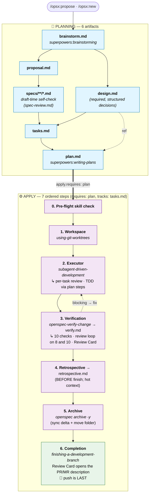

# superpowers-bridge Schema

[English](./README.md) · [繁體中文](./README.zh-TW.md) · [Tiếng Việt](./README.vi-VN.md)

[](https://github.com/AdrianTheopold/openspec-schemas/actions/workflows/validate-schemas.yml)
[](#compatibility)
[](#compatibility)

> Bridges [OpenSpec](https://github.com/Fission-AI/OpenSpec)'s artifact governance (the **what**) with [obra/superpowers](https://github.com/obra/superpowers) execution skills (the **how**) into a single workflow. Adds an evidence-first `retrospective` artifact filling a gap Superpowers does not natively cover.
>
> The integration lives entirely at the prompt layer — no Superpowers source modified, no OpenSpec CLI changes. Schema version: v1.
>
> **Fork** of [JiangWay/openspec-schemas](https://github.com/JiangWay/openspec-schemas) (upstream commit `f5d4040`), independently maintained since 2026-07-02 as the actively-maintained working fork (upstream is inactive); it diverges as needed and is not aimed at upstream PR-back.

---

## Install

### Method 1: Claude Code one-shot prompt (recommended)

Copy and paste this into Claude Code in your project root:

```
Install the superpowers-bridge schema for OpenSpec into this project:

1. Verify the project has an `openspec/` directory (run `openspec init` if missing).
2. Clone https://github.com/AdrianTheopold/openspec-schemas to a temp dir.
3. Copy the `superpowers-bridge/` subdirectory to `openspec/schemas/superpowers-bridge/`.
4. Run `openspec schema validate superpowers-bridge` to verify.
5. Run `openspec schemas` and confirm `superpowers-bridge` is listed.
6. If a CLAUDE.md exists at the project root, ask me whether to insert the workflow-routing fragment from `openspec/schemas/superpowers-bridge/templates/adopters/CLAUDE.md.fragment.<locale>.md` (auto-detect locale from existing CLAUDE.md content; default zh-TW for Traditional Chinese, no suffix for English). If I say yes, append the fragment as a new section. If no CLAUDE.md exists, skip.
7. Clean up the temp directory.
8. Verify Superpowers plugin is installed by running `claude plugin list`.
   If not listed, run `claude plugin install superpowers@claude-plugins-official`.
9. Show me the final state.
```

### Method 2: Manual bash (CI / non-Claude environments)

```bash
git clone https://github.com/AdrianTheopold/openspec-schemas /tmp/oss
cp -R /tmp/oss/superpowers-bridge ~/your-project/openspec/schemas/superpowers-bridge

# Optional: insert workflow-routing fragment into CLAUDE.md
# cat /tmp/oss/superpowers-bridge/templates/adopters/CLAUDE.md.fragment.md       # English
# cat /tmp/oss/superpowers-bridge/templates/adopters/CLAUDE.md.fragment.zh-TW.md # zh-TW

rm -rf /tmp/oss
cd ~/your-project
openspec schema validate superpowers-bridge
claude plugin install superpowers@claude-plugins-official  # if not already
```

---

## Upgrading an existing install

If your project already has `openspec/schemas/superpowers-bridge/` and you want to pull the latest version, use one of the upgrade methods below. The upgrade overwrites the entire `superpowers-bridge/` directory and offers a CLAUDE.md fragment update — see "What the upgrade overwrites" below.

### Upgrade Method 1: Claude Code one-shot prompt (recommended)

In your project root, paste this into Claude Code:

```
Upgrade the superpowers-bridge schema in this project:

1. Verify `openspec/schemas/superpowers-bridge/` already exists (upgrade, not fresh install). If missing, abort and tell me to use the install instructions instead.
2. Clone https://github.com/AdrianTheopold/openspec-schemas to a temp dir.
3. Show me the diff between the local `openspec/schemas/superpowers-bridge/` and the cloned `superpowers-bridge/` (use `diff -ruN`). Wait for my ack before overwriting.
4. After my ack, overwrite the local schema dir with the cloned one.
5. Run `openspec schema validate superpowers-bridge` to verify.
6. Check whether this project has `CLAUDE.md` at the repo root.
   - If yes: scan it for an existing workflow-routing section referencing superpowers-bridge.
     - If found: show me the diff between that section and `superpowers-bridge/templates/adopters/CLAUDE.md.fragment.<locale>.md`. Wait for my ack before replacing.
     - If not found: ask whether to insert the new fragment from `templates/adopters/CLAUDE.md.fragment.<locale>.md`.
   - If no CLAUDE.md exists: skip.
7. Clean up the temp directory.
8. Show me the final state.
```

> `<locale>` defaults to `zh-TW` if your CLAUDE.md is in Traditional Chinese, or no suffix (English). Claude detects from existing CLAUDE.md content.

### Upgrade Method 2: Manual bash

```bash
# 1. Get the latest bundle
git clone https://github.com/AdrianTheopold/openspec-schemas /tmp/oss-upgrade

# 2. Review the diff first (don't overwrite blindly)
diff -ruN ~/your-project/openspec/schemas/superpowers-bridge /tmp/oss-upgrade/superpowers-bridge

# 3. After reviewing, overwrite
rm -rf ~/your-project/openspec/schemas/superpowers-bridge
cp -R /tmp/oss-upgrade/superpowers-bridge ~/your-project/openspec/schemas/superpowers-bridge

# 4. Validate
cd ~/your-project && openspec schema validate superpowers-bridge

# 5. CLAUDE.md fragment (manual)
# View /tmp/oss-upgrade/superpowers-bridge/templates/adopters/CLAUDE.md.fragment.md
# Compare against your CLAUDE.md and insert/update the corresponding section as needed

# 6. Clean up
rm -rf /tmp/oss-upgrade
```

### What the upgrade overwrites

| Path | Action | Manual step? |
|---|---|---|
| `openspec/schemas/superpowers-bridge/` | Auto-overwritten — entire directory replaced from upstream (`rm -rf` + `cp -R` in Method 2; equivalent in Method 1) | None |
| `CLAUDE.md` (project root) | The schema dir ships `templates/adopters/CLAUDE.md.fragment.<locale>.md`; the upgrade procedure diffs your existing CLAUDE.md against this fragment and waits for your ack before inserting / replacing | Yes — review diff, choose insert / replace / keep |

> The bridge directory is monolithic — you take the whole new version or stay on the old one. There is no per-file opt-in. CLAUDE.md is the only project-root file the upgrade ever touches, and never without your ack.

> In-flight changes (any phase: brainstorm / design / specs / ...) remain valid because the schema graph (`requires:` edges, PRECHECKs, artifact dependencies) hasn't changed in v1.x. Existing `verify.md` / `retrospective.md` from before the upgrade are still readable; if you re-run `/opsx:verify` or `/opsx:continue → retrospective` on them, the new template structure applies on overwrite.

> If a future upgrade modifies the schema graph structurally (artifact add/remove, `requires:` edge changes, PRECHECK changes), the README will gain a version field and a migration guide. v1 → v1.x prose-only changes are safe and do not need migration.

---

## What problem does this solve?

OpenSpec governs **what to do** (artifact lifecycle: proposal / specs / tasks / verify, etc.). Superpowers governs **how to do it** (execution discipline: brainstorming, writing-plans, TDD, code review). Each is solid on its own; interleaving them in real development surfaces three structural problems:

1. **Output duplication** — brainstorming writes design output to `docs/superpowers/specs/`; OpenSpec re-authors `proposal.md` / `design.md` in the change directory, with overlapping content.
2. **Task fragmentation** — OpenSpec's `tasks.md` (coarse checkboxes) and Superpowers' `plan.md` (TDD micro-steps) describe the same work in different formats, locations, and progress trackers.
3. **Manual orchestration** — the user has to decide on every step which skill to invoke; the two systems do not connect on their own.

### Why a custom schema rather than modifying existing skills?

Two alternatives were considered and rejected:

- **Adding custom fields to `config.yaml`** (e.g., `skill_bindings`): the OpenSpec CLI does not recognize them — no validation, no discoverability, requires editing multiple SKILL.md files.
- **Editing the opsx skill files directly**: invasive (affects every change) and fragile (overwritten on SKILL.md upgrade).

A custom schema uses OpenSpec's **native project-level schema mechanism**: the CLI validates structure, `openspec schemas` lists it automatically, each change picks its schema independently (`--schema spec-driven` or `--schema superpowers-bridge`), and no existing SKILL.md or command file is modified.

---

## Entry & exit gates

This schema's instructions only fire when invoked through `/opsx:*` commands. If you trigger Superpowers skills via narrative — for example, by saying "let's discuss the architecture" — the default behavior bypasses the schema. Brainstorming will still write to `docs/superpowers/specs/`, defeating the integration's redirection.

This section covers three things:

1. When you don't need to enter the schema at all (just open a PR)
2. When verbal brainstorming should be promoted to an opsx change
3. Front-door anti-patterns to avoid once the schema is installed

### When NOT to enter the schema (direct PR)

Not every change needs a `change` directory. The following scenarios should skip opsx entirely:

| Scenario | Need a change? | What to do |
|---|---|---|
| New feature / new capability | ✅ Yes | `/opsx:new <name> --schema superpowers-bridge` |
| Breaking change | ✅ Yes | Same |
| Architecture change | ✅ Yes | Same |
| Bug fix (restoring intended behavior, no contract change) | ❌ No | Direct PR |
| Test backfill / coverage | ❌ No | Direct PR |
| Build tooling tweak (linter rule, coverage threshold) | ❌ No | Direct PR |
| Non-breaking dependency upgrade | ❌ No | Direct PR |
| Documentation update / typo fix | ❌ No | Direct PR |
| Config value tweak (no structural change) | ❌ No | Direct PR |

> Principle: **process ceremony should scale with risk**. External contracts, cross-system integration, DB schema changes, compliance boundaries → run a change. Typos, bug fixes, timeout adjustments → direct PR. For ambiguous cases, use the 5-condition checklist below.

### When verbal brainstorming should be promoted to a change

If `superpowers:brainstorming` was triggered via narrative ("let's brainstorm the architecture") in a project that uses this schema, the brainstorming output **MUST NOT** land in `docs/superpowers/specs/` — that bypasses the schema's output redirection and creates orphan artifacts.

The correct flow: keep brainstorming verbally until all 5 conditions below hold, then promote to `/opsx:propose` or `/opsx:new` so the agreed design lands in `openspec/changes/<name>/brainstorm.md`.

1. **Scope locked** — one sentence describes what's in / out, and the scope doesn't keep growing each turn
2. **Major design forks resolved** — alternatives have been weighed and one chosen; remaining unknowns are **explicit TBDs** (with owner and impact-scope statement), not "haven't thought about it yet"
3. **Cross-system dependencies mapped** — for each dependency: ready / mockable / genuinely unknown — pick one
4. **Acceptance criteria stateable** — concrete pass conditions (e.g., `./mvnw clean verify` passes + N specific deliverables)
5. **Conversation converging** — the last 1-2 turns are confirmations, not new "what about..." forks

If any condition is missing, keep brainstorming. When all five hold:
- The model **should proactively suggest** "this looks ready for `/opsx:propose` — want to open a change?"
- The user **may also explicitly say** "open this as an opsx change"
- Either way, **promotion requires a deliberate human ack** — never automatic

### Front-door anti-patterns

| Anti-pattern | Why it's wrong |
|---|---|
| Letting brainstorming write to `docs/superpowers/specs/` after the schema is installed | Bypasses the `IMPORTANT output redirection` block in the **brainstorm** artifact's instruction ([schema.yaml](./schema.yaml)); produces orphan artifacts. Verify §6 detects it. |
| Letting writing-plans write to `docs/superpowers/plans/` | Same reason — the equivalent block in the **plan** artifact's instruction. Verify §6 detects it. |
| Promoting to opsx with unresolved blocking TBDs | Those TBDs will block apply phase too — promotion just defers the same problem |
| Opening a change for bug fix / typo / config tweak | Process ceremony exceeds actual risk; slows delivery without value |

---

## Workflow & integration

### Artifact DAG

```text
brainstorm ──┬──→ proposal ──→ specs ──┐
             │                         ├──→ tasks ──→ plan ──→ [apply] ──→ verify ──→ retrospective
             └──→ design ──────────────┘
```

Differences from `spec-driven`:

| | spec-driven | superpowers-bridge |
|---|---|---|
| Entry | proposal (manual) | **brainstorm** (invokes brainstorming skill) |
| Plan layer | tasks (coarse) | tasks + **plan** (TDD micro-steps) |
| apply requires | tasks | **plan** |
| apply method | standard task-by-task | **worktree + subagent-driven-development** (per-task review; TDD via the plan's test-first steps) |
| Post-apply | (none) | **verify** (10 checks) + **retrospective** artifacts |
| Review | (none) | **spec review** at draft time and in verify; **security pass** in verify; the agent clears their findings; a **review card** on the PR/MR |
| New artifacts | — | brainstorm, plan, verify, retrospective |

### Lifecycle (apply orchestration + timing notes)

The Artifact DAG above shows **file-existence** dependencies. The runtime lifecycle below adds the apply phase's ordered steps and the **timing offsets** between graph edges and actual production order.



ASCII fallback (CLI-readable):

```text
PLANNING ━━━━━━━━━━━━━━━━━━━━━━━━━━━━━━━━━━━━━━━━━━━━━━━━━━━━━━
  brainstorm.md ──┬─→ proposal.md ──→ specs/**/*.md ──┐
                  │                                   ├─→ tasks.md ──→ plan.md
                  └─→ design.md (required) ───────────┘
                         (draft-time spec self-check)                  │
                          apply.requires: [plan], apply.tracks: tasks  ▼
APPLY ━━━━━━━━━━━━━━━━━━━━━━━━━━━━━━━━━━━━━━━━━━━━━━━━━━━━━━━━
  0. Pre-flight skill check
  1. superpowers:using-git-worktrees
  2. superpowers:subagent-driven-development (+ per-task review; TDD via plan steps)
  3. openspec-verify-change → verify.md (10 checks, Review Card) ◄┐
                              │                                   │ blocking → fix
                              ▼                                   │
  4. retrospective.md (BEFORE PR; hot context)
  5. openspec archive -y (sync delta + move folder)
  6. superpowers:finishing-a-development-branch (Review Card in the PR/MR description; 🏁 push is LAST)
```

Two review points sit in the flow, both before the PR/MR exists. The first is the **draft-time spec review**: a note in `templates/spec.md` tells the drafting agent to run [spec-review.md](./spec-review.md) against the delta spec before finishing it. The second is verify: **check 8** runs the same rule file in a fresh subagent, **check 9** reports where the change departs from the adopter's governing sources, and **check 10** reviews the diff for security defects. The agent clears the findings of checks 8 and 10 itself; the human reads one artifact, the review card, at merge time.

> **Timing notes** (full rationale in "Six design touches" #6):
> - `verify.md` declares `requires: plan` in the graph but is actually produced inside apply step 3.
> - `retrospective.md` declares `requires: verify` and per Step 4 is produced **before** finish/push (step 6) — so the pushed branch includes the complete archived cycle (all artifacts done, spec synced, change folder under `archive/`).
> - Checks 8 and 10 block verify until their findings are cleared, so the PASS that gates steps 4–5 only arrives after the review loop (see "Six design touches" #6).
> - The `requires:` edges are file-existence dependencies for OpenSpec's graph engine; runtime ordering lives in instruction prose.

### Seven Superpowers touchpoints

| # | Superpowers skill | Where it's invoked | Trigger |
|---|---|---|---|
| 1 | `superpowers:brainstorming` | `brainstorm` artifact instruction | Direct (with PRECHECK) |
| 2 | `superpowers:writing-plans` | `plan` artifact instruction | Direct (with PRECHECK) |
| 3 | `superpowers:using-git-worktrees` | apply step 1 | Direct |
| 4 | `superpowers:subagent-driven-development` | apply step 2 | Direct |
| 5 | `superpowers:test-driven-development` | (followed inside #4 through the plan's test-first steps) | **Via plan** |
| 6 | `superpowers:requesting-code-review` | (its reviewer prompt runs #4's final review) | **Transitive** |
| 7 | `superpowers:finishing-a-development-branch` | apply step 6 | Direct |

Plus one OpenSpec built-in: `openspec-verify-change` (apply step 3, produces `verify.md`).

> **No `executing-plans` fallback.** This schema is opinionated: it requires a subagent-capable platform (Claude Code, Codex, etc.). The alternative executor `superpowers:executing-plans` implements every task itself in one context, with no reviewer per task (verified against its [SKILL.md](https://github.com/obra/superpowers/blob/v7.0.0/skills/executing-plans/SKILL.md)). Since Superpowers 6.4.1 it does load TDD and verification-before-completion and ends with one fresh whole-branch review, but it gives up the fresh context per task and the per-task review gate this schema's apply phase is built on — falling back would silently drop them. If your platform lacks subagent support, use the built-in `spec-driven` schema instead.

### Output redirection

Superpowers skills have default output paths (e.g., brainstorming writes to `docs/superpowers/specs/`). This schema's artifact instructions **override** that behavior by injecting context that redirects output into the change directory:

- brainstorming → `openspec/changes/<name>/brainstorm.md`
- writing-plans → `openspec/changes/<name>/plan.md`

Implemented purely via context injection at invocation time, not by modifying skill source.

---

## Usage

### Quick flow (recommended)
```bash
/opsx:ff my-feature    # one-shot: scaffold + brainstorm + proposal + design + specs + tasks + plan
/opsx:apply            # worktree + subagent-driven-development (per-task review; TDD via plan steps)
/opsx:verify           # produces verify.md (10 checks) and its Review Card
/opsx:continue         # → retrospective (produces retrospective.md, §0 + 6 sections)
/opsx:archive          # archive
```

### Step-by-step flow
```bash
/opsx:new my-feature --schema superpowers-bridge
/opsx:continue         # → brainstorm (interactive dialogue)
/opsx:continue         # → proposal
/opsx:continue         # → design (reorganize brainstorm into structured decisions)
/opsx:continue         # → specs
/opsx:continue         # → tasks
/opsx:continue         # → plan
/opsx:apply            # → implementation + worktree + subagent-driven-development
/opsx:verify           # → verify.md (post-apply, runs the 10 checks, fills the Review Card)
/opsx:continue         # → retrospective.md (post-verify, evidence-first §0 + 6 sections)
/opsx:archive
```

> **Profile note — this bridge's opsx flow requires OpenSpec's expanded workflow profile.** The **core** profile (the `openspec init` default) provides only `propose, explore, apply, sync, archive`; the expanded-only commands are `new, continue, ff, verify, bulk-archive, onboard` — and this bridge's flows lean on `/opsx:continue`, `/opsx:ff`, and `/opsx:verify` throughout, not just `/opsx:new`. Enable the expanded set by running `openspec config profile` (select the full workflow set in the picker) and then `openspec update`; running `openspec update` alone does **not** switch profiles. If you must stay on core, only the first step has a CLI equivalent (`openspec new change <name> --schema superpowers-bridge`) — `/opsx:continue`/`/opsx:verify` have none, so the expanded profile is effectively required. (`/opsx:new` is the only create-command that accepts `--schema`; `/opsx:propose` and `/opsx:ff` use your project's default schema.)

### Switching back to spec-driven
```bash
# Use a different schema for one change
/opsx:new my-simple-fix --schema spec-driven

# Or change project default in openspec/config.yaml: schema: spec-driven
```

---

## Apply phase walkthrough

`/opsx:apply` triggers the steps inside [schema.yaml](./schema.yaml)'s `apply.instruction`:

#### 0. Pre-flight — verify required Superpowers skills

Confirms these skills are installed before proceeding:

- `superpowers:using-git-worktrees`
- `superpowers:subagent-driven-development`
- `superpowers:test-driven-development` (followed through the plan's test-first steps; SDD does not load it itself)
- `superpowers:requesting-code-review` (its reviewer prompt runs SDD's final whole-branch review)
- `superpowers:finishing-a-development-branch`

Missing skill → STOP with explicit error. No silent fallback, no manual mode within this schema. The user should either install Superpowers or switch to the built-in `spec-driven` schema for that change.

> The v0 version of this schema once placed an "auto-commit change artifacts to current branch" step here. It was removed after the [PR #970 review](https://github.com/Fission-AI/OpenSpec/pull/970): handling untracked change directories is the worktree skill's responsibility, not the schema's.

#### 1. Workspace — `superpowers:using-git-worktrees`

Creates `.worktrees/<change-name>/`, switches to a new branch, runs setup, confirms a clean test baseline.

#### 2. Executor — `superpowers:subagent-driven-development`

Main agent reads `plan.md`, dispatches a fresh subagent per micro-task:

- **TDD** (`superpowers:test-driven-development`): reaches each task through the plan, not through SDD — the plan artifact requires every behavior task to open with "write the failing test" and "run it, expect it to fail", and SDD's implementer writes tests "following TDD if task says to", reporting RED and GREEN evidence that the task reviewer reads
- **Per-task review**: after each task the controller dispatches subagent-driven-development's own merged task-reviewer (spec-compliance + code-quality) — not a separate skill invocation; critical issues block forward motion

Every brief carries plan.md's Global Constraints, which hold the comment rule, the commit-trailer rule and the adopter's safety rules. The controller stops and asks the human before any action those rules, or the adopter's apply guidance, reserve for a human, in addition to Superpowers' own stop classes; with no safety rules and no apply guidance, those classes are the whole stop rule. See [Configuration keys](#configuration-keys).

Both committed ledgers tick as tasks complete — the coarse `tasks.md` checkboxes and the cleared task's `plan.md` step boxes — in the same bookkeeping step as the SDD progress-ledger line. A step deferred rather than cleared is marked `[~]` in `plan.md` at that moment, because that is what verify §7 reads. After all tasks, a final whole-branch code review (`superpowers:requesting-code-review`) covers the implementation.

This schema does NOT support `superpowers:executing-plans` as a fallback. See the "Six design touches" section below for rationale.

#### 3. Verification — `openspec-verify-change`

Produces `verify.md` from 10 checks:

1. structural validation (`openspec validate --all --json`)
2. task completion
3. delta-spec sync state
4. design/specs coherence (non-blocking warning)
5. implementation signal (committed code)
6. front-door routing leak detector (non-blocking warning)
7. deferred-dogfood vs automated-test equivalence — blocks only when `plan.md` has `[~]` deferrals but the equivalence section is empty (gap analysis skipped); otherwise informational
8. **spec review** — a fresh subagent runs [spec-review.md](./spec-review.md) against the delta specs: the rules `openspec validate --strict` does not cover, so that what reaches `openspec/specs/` reads correctly once merged. Findings block verify until the agent fixes them or dismisses each with a recorded reason; after three runs with findings, the next run reviews only what changed and anything still open goes to the review card. A clean run reports `No findings.`
9. **deviation report** — a fresh subagent reads the governing sources the adopter names (at the version its trunk holds, never from a branch amending them), the change's artifacts and its diff, and reports every point where the change contradicts, drops or goes beyond a source, each with a reason, the cost if the reasoning is wrong and a proposed edit to the source. A deviation does not fail verify: accepting it, amending the source or reversing the code is the human's call at merge time. A missing report, a deviation without a reason, or an unreadable source does fail it. A clean run reports `No deviations from the governing sources.`; with no sources configured it records `No governing sources configured` and passes
10. **security pass** — the diff against the branch it merges into is reviewed for security defects in a fresh context, by a fresh subagent that uses the runtime's own security review where one ships (in Claude Code, `/security-review`), and a fixed reading list otherwise or where that review's coverage falls short of the diff. The agent fixes each finding or dismisses it with a reason; a finding whose fix would change behavior a governing source states becomes a deviation for check 9

Failures route back to the corresponding artifact for fix; verify can be re-run. When no blocking issue is left, the controller fills the `## Review Card` section of `verify.md`: **Deviations** (check 9's report) and **What the checks did not cover** (the sensitive areas the diff touches, checks that did not run or ran on a fallback path, findings left open) are the two parts to read; **Evidence**, **Security pass**, **How to revert** and **Rulings** are for a glance. The card is a view of `verify.md`, which stays the record, and step 6 puts it at the top of the PR/MR description.

> **Steps 4–6 are the canonical post-verify sequence: retro → archive → PR. Reordering produces incomplete PRs (retrospective + archive land as trailing post-merge commits, losing hot context).**

#### 4. Retrospective — `retrospective` artifact (recommended; per Entry & exit gates skip rules, trivial fixes may skip)

Evidence-first reflection: §0 Evidence (quantitative front-matter — commit count, diff size, tasks-done ratio, dependencies, validate state, etc.) plus 6 analysis sections (Wins / Misses / Plan deviations / Skill compliance / Surprises / Promote candidates). Each claim cites a commit / file / measurable fact, typically referencing §0 instead of inlining evidence per bullet. The procedure is embedded in the artifact's instruction — no external skill required (Decision 3 in the design spec defers Claude Code plugin packaging to v1.x).

Written **before** opening the PR so retro lands in the same PR diff.

#### 5. Archive — `openspec archive -y` (or `/opsx:archive`)

Syncs delta specs into `openspec/specs/<capability>/spec.md` and moves the change folder to `openspec/changes/archive/YYYY-MM-DD-<name>/`. Run **before** the PR opens so the diff reflects the complete archived cycle (all artifacts done, spec synced, folder under archive/).

#### 6. Completion — `superpowers:finishing-a-development-branch`

Confirms tests are green, presents merge / PR / keep-branch / discard options. The Review Card from `verify.md` goes at the top of the PR/MR description (edited in afterwards if the request was created without it); an unfilled card is a STOP, not something to skip. The bundle posts no inline review comments of its own. The worktree is cleaned up only on the merge or discard options; the push/PR path preserves it so you can iterate on PR feedback. **PR is the last step** — if retro or archive haven't been done, finish them first.

---

## Configuration keys

The bundle holds no adopter content. An adopter's governing sources, deviation threshold and safety rules stay in its own sources, and `openspec/config.yaml` — OpenSpec's project configuration — **points** at them: it names where a ruleset lives and how to load it (a file path, a URL, or a command), never a copy, so a rule changes in one place and needs no bundle release. The bundle reads four keys:

| Key | Delivered with | What the bundle does with it |
|---|---|---|
| `context` | every artifact's instructions | Names the governing sources and how to read them. Check 9 reads them at the version the adopter has accepted (its trunk), never from a branch that amends them, and records each source's review status as read. |
| `rules.verify` | the verify artifact's instructions | Narrows or widens what check 9 counts as a deviation (default: the change contradicts, drops or goes beyond what a source states, a stated non-goal included), says how a proposed edit reaches its source, and names the sensitive areas the review card lists when the diff touches them. |
| `rules.plan` | the plan artifact's instructions | The safety rules, or a pointer to where they live. The plan instruction puts them in `plan.md`'s Global Constraints as given, rules or pointer (a pointer tells every implementer to load the rules before its first action), so they reach every implementer brief and the task reviewer. |
| `operations.apply.guidance` | the apply instructions (the `operationGuidance` field of `openspec instructions apply --json`) | Anything the controller must hold to during apply, such as which actions to stop for. Added to every brief the controller dispatches. |

A minimal example, with a neutral `orders` domain:

```yaml
schema: superpowers-bridge
context: |
  Governing sources: orders-direction.md in the repository at <path>.
  Read it at that repository's trunk with `git -C <path> show main:orders-direction.md`,
  never from its working tree.
rules:
  verify:
    - "Sensitive areas: CI configuration (.github/workflows/)."
```

Without these keys the bundle behaves as before: check 9 records `No governing sources configured` and passes, the review card lists no sensitive areas, Global Constraints carry only the bundle's own comment and commit-trailer rules, and the four Superpowers stop classes are the whole stop rule.

A rule about the content of code (no secret values, no disabled certificate check) is better enforced by a deterministic per-edit check than by a brief: for example a pattern hook the runtime runs on every edit, in the main session and in subagents alike. Which check, if any, is adopter configuration, not bundle content.

---

## CLI cheat sheet

| Scenario | Command |
|---|---|
| New change (interactive) | `/opsx:new <name> --schema superpowers-bridge` then `/opsx:continue` |
| New change (one-shot) | `/opsx:ff <name>` |
| Resume an interrupted change | `/opsx:continue <name>` |
| Enter implementation | `/opsx:apply <name>` |
| Manual verify | `/opsx:verify <name>` |
| Archive | `/opsx:archive <name>` |
| Use built-in (skip brainstorm) | `/opsx:new <name> --schema spec-driven` |
| List all schemas in the project | `openspec schemas` |
| Inspect a change's progress | `openspec status --change <name> --json` |
| List active changes | `openspec list` |
| Validate the entire project | `openspec validate --all --json` |

---

## Six design touches worth remembering

### 1. Skill-name PRECHECK (Layer 1 capability detection)

Each artifact / apply step that invokes a Superpowers skill runs a PRECHECK at the start of its instruction, confirming the skill exists in the LLM's available skills list. **Missing skill = STOP, no silent fallback.** This is the concrete answer to layer 1 of [PR #970 review](https://github.com/Fission-AI/OpenSpec/pull/970)'s concern #1 — fail loud, fail early.

### 2. Schema-level vs prompt-level integration

Integration lives entirely in `instruction:` fields (pure prompts). If Superpowers upgrades a skill's behavior, the schema doesn't change. We only touch `schema.yaml` if a skill is renamed or removed.

### 3. Where TDD and code review come from, made explicit

Code review happens inside `subagent-driven-development`: its own merged task reviewer after every task, and `requesting-code-review`'s reviewer prompt for the final whole-branch review. TDD does not: SDD's SKILL.md has not named `test-driven-development` since Superpowers 6.2.0, and its implementer follows TDD only when the task says to. So the plan artifact requires test-first steps in every behavior task, and apply step 2 says where each discipline comes from, so a reader can see "what actually happens during apply" at a glance — and why `plan.md` must reach the executor with its test-first steps intact.

### 4. Opinionated: subagent platforms only, no manual fallback

This schema requires a subagent-capable platform (Claude Code, Codex, etc.). The alternative executor `superpowers:executing-plans` was rebuilt in Superpowers 6.4.1: it now requires `test-driven-development` before Task 1 and `verification-before-completion` for each task's completion claim, and ends with one fresh-context review of the whole branch using `requesting-code-review`'s reviewer prompt (verified against its [SKILL.md](https://github.com/obra/superpowers/blob/v7.0.0/skills/executing-plans/SKILL.md)). What it still does not do is what this schema's apply phase is built on: it runs every task in the executor's own context — "no implementer subagent per task, no reviewer per task" — so there is no fresh context per task and no per-task review gate (spec compliance + code quality) before the next task starts. Falling back to it would silently lose that gate. We prefer to fail loud at Step 0 and direct users to the built-in `spec-driven` schema instead.

### 5. Evidence-based PRECHECK for verify and retrospective (Layer 2 capability detection)

Each timing-sensitive artifact runs concrete shell evidence checks at the start of its instruction:

- **verify**: `git log <base>..HEAD | wc -l > 0` AND `grep -cE '^\s*([-*+]|[0-9]{1,9}[.)])\s*\[\s*[xX]\s*\]([^([]|$)' tasks.md > 0` AND `grep -cE '^\s*([-*+]|[0-9]{1,9}[.)])\s*\[\s*[xX~]\s*\]([^([]|$)' plan.md > 0`
- **retrospective**: `test -f verify.md` AND `! grep -q '^- \[x\] ❌ FAIL' verify.md`

The LLM does not need to interpret timing prose — it runs commands and reads results. This is layer 2 of concern #1 / mitigation for concern #2.

### 6. verify and retrospective are time-mismatched artifacts (known limitation)

`verify.requires: [plan]` and `retrospective.requires: [verify]` are file-existence dependencies in the schema graph, but each instruction explicitly states "MUST run AFTER apply phase / verify pass". This is intentional misalignment — OpenSpec's engine only checks predecessor file existence. Engine-native fix awaits a `post_apply` phase concept upstream (analogous to spec-kit's `after_implement` hook); evidence-based PRECHECK above is the v1 mitigation.

Since 1.5.0 the same misalignment bites harder, because checks 8 and 10 block: verify runs as a loop inside apply step 3 (find, fix through an implementer subagent, commit, re-run) rather than a single pass, and each run records the commit it reviewed so the next run, and the capped run, know their base. Verify's PRECHECK still reads only observable state (commits, ticked boxes). A finding still open after the capped run does not hold verify at FAIL: it sets Overall Decision to PASS WITH WARNINGS and goes to the review card, so the retrospective and archive that follow are not blocked by a finding the agent could not clear. Because the review card is committed with `verify.md` before archive, it travels into the archived change and into the PR/MR diff.

---

## Versioning

This bundle carries **two version identifiers** that should not be confused:

| Identifier | Where | Meaning | Example |
|---|---|---|---|
| Schema major | `schema.yaml: version: 1` | Contract of the schema graph (artifacts, `requires:` edges, PRECHECK shape). Breaking changes bump this. | `1` |
| Bundle release | `VERSION` file + git tag | SemVer release of this bundle, scoped to a schema major. | `1.0.0` (tagged `v1.0.0`) |

A bundle release `1.x.y` is a published cut of schema major `v1`. A future schema major `v2` will restart bundle releases at `2.0.0`. Adopters who pin to `v1.x.y` are guaranteed schema-graph compatibility within the v1 major.

> The compatibility matrix below uses `v1` (schema major) as the row key, because compatibility with OpenSpec / Superpowers is governed by the schema contract, not by patch-level edits inside this bundle.

## Compatibility

Baseline versions this schema was authored against. This is a **historical snapshot, not an end-to-end compatibility guarantee** — CI cannot run the full prompt-layer workflow in headless mode, so behavioral compatibility relies on human review when drift fires.

Current bundle release: **`1.5.0`** (see [VERSION](./VERSION)).

| superpowers-bridge | OpenSpec CLI | Superpowers plugin | Baseline as of |
|---|---|---|---|
| v1 | `1.14.3` | `7.0.0` | 2026-10-21 |
| v1 | `1.13.0` | `6.3.0` | 2026-09-16 |
| v1 | `1.5.0` | `6.2.0` | 2026-08-12 |
| v1 | `1.5.0` | `6.1.0` | 2026-07-02 |

> Bundle **1.5.0** adds no schema-graph change (the same artifacts, `requires:` edges and PRECHECKs) and no baseline bump; the baselines above stand. It adds the draft-time note in `templates/spec.md`, the spec review, deviation report and security pass to verify, the Global Constraints rules to plan, and the stop rule, review loop and review card to apply, and a tally of dismissal reasons to the retrospective. Its acceptance suite, `acceptance/superpowers-bridge/run.sh check`, pins on the CLI the message texts the checks read (`Archive would refuse this delta`, `Purpose section is still a placeholder`, the `--strict` failure on an ADDED requirement over 500 characters, the `proposal.md` parse status), so a CLI release that rewords one fails the run instead of silently emptying a check.
>
> Re-attested against **OpenSpec 1.14.3** (2026-10-21, bundle 1.4.1) on the OpenSpec side. Structural: `openspec schema validate` passes, instructions render for every artifact and for apply, and a probe change written from the templates passes `openspec validate --strict`. Absorbed from the 1.14.3 `spec-driven` text into the four inherited instructions: **proposal** — name a new capability for a durable system behavior, not for the work in this change, with a cohesive boundary and no catch-all; **specs** — write the spec files one at a time, starting at the first listed capability with no file; keep a requirement's description to 500 characters, one behavior per requirement (`--strict` fails on a longer ADDED one), and never trim an existing requirement under MODIFIED just to meet the length; `## Purpose` is a new capability delta's first section; **tasks** — only a box holding `x` counts as done (every other marker, `[~]` included, reads as unfinished), work outside tracked progress goes as plain bullets in an optional `## Workflow follow-up` section, and each task group lands its own tests and documentation. **design** is unchanged upstream. Templates gain the upstream H1 titles and the capability-naming and length rules. Adapted to the bridge: the `[~]` deferral marker stays in `plan.md` only, and the workflow follow-up names apply steps 3–6 — tracked tasks never cover verify, retrospective, archive or finish, because verify's task-completion check needs every `tasks.md` box ticked before archive. Carried through unchanged: the brainstorm-first framing, the spec-inventory paragraph, the MODIFIED-completeness paragraph (no upstream counterpart), the `tasks.md` / `plan.md` ledger split. Left out on purpose, as in 1.4.0: the `--store` arguments (stores stay unused).
>
> Re-attested against **Superpowers 7.0.0** (2026-10-21, bundle 1.4.1) via a full v6.4.2→v7.0.0 skill diff, installed copy confirmed identical to the upstream tag. One behavioral change absorbed: **brainstorming** was rebuilt. It no longer classifies spike / bounded / architectural; it sizes the work as a quick task, a small change or a project with a written design. Its first message offers to skip the questions, and taking that offer ends the skill with no document. It shows a comparison of approaches only when that helps the user decide, plays the design back in chunks of about 200–300 words, and has a fresh builder-check subagent read the written design before handover. The brainstorm instruction now answers "a project with a written design", closes the skip exit for this flow (the manual `brainstorm.md` path remains), and stops the skill's writing-plans handoff, because the plan is a later artifact here. Still holding: the written design defaults to `docs/superpowers/specs/` and yields to the user's preference, so the output redirection stands. Not affecting the bridge: the spec-document-reviewer prompt was removed (the builder check replaces it); `sdd-workspace` no longer overwrites an existing `.superpowers/sdd/.gitignore` and still resolves the workspace under `.superpowers/sdd/`; `executing-plans`' `task-done` script and the `requesting-code-review` example changed in shell detail only. Also corrected here, though stale since **6.2.0**: the bundle claimed SDD transitively enforces TDD. SDD's SKILL.md has not named `test-driven-development` since v6.2.0 (it did at v6.1.0), and its implementer prompt says only "Write tests (following TDD if task says to)". TDD reaches each task through writing-plans' test-first steps ("Write the failing test" as a task's first step), so the plan instruction now requires those steps and apply step 2, the touchpoint table and design touch #3 state that mechanism. The no-fallback rationale no longer leans on TDD: `executing-plans` loads TDD itself; the decision rests on per-task review and fresh context per task.
>
> Re-attested against **Superpowers 6.4.2** (2026-10-21, bundle 1.4.1) via the v6.4.1→v6.4.2 skill diff — only `writing-plans` changed. Absorbed into the plan instruction: a step is "one action with a checkable result" instead of a 2–5-minute action; a code step gives the exact signature, file and spec-pinned values, and carries a body only for an algorithm the signature and tests do not determine; the Self-Review's placeholder scan became a step scan, and a fifth check, Proportion, compares the plan's length to the spec's. The plan instruction's reuse-check rationale still holds — all five checks compare the plan to the spec or to itself, none to the codebase — and its count was corrected.
>
> Re-attested against **Superpowers 6.4.1** (2026-10-21, bundle 1.4.1) via the v6.3.0→v6.4.1 skill diff. Two corrections absorbed: (1) **executing-plans** was rebuilt — it now requires `test-driven-development` and `verification-before-completion`, shares SDD's workspace and ledger, rules instead of asking, and ends with one fresh whole-branch review — so this README's earlier claim that it activates neither TDD nor code-review became false at this release. The no-fallback decision stands on the reason that is still true: no reviewer and no fresh context per task. (2) **writing-plans** added a Review Focus section and a fourth self-review check, and its handoff now asks the human to review the plan and choose Subagent-driven or Native unless a method was already supplied; the plan instruction supplies subagent-driven so the "already supplied" branch runs. Still holding from 6.4.1 through 7.0.0: every PRECHECK skill name; SDD's rulings, its four stop classes, its "Rulings I made" list, its merged task reviewer and its final whole-branch review; SDD still ends by invoking finishing with no flag to disable it (the apply suppression stays necessary); the default output paths `docs/superpowers/specs/` and `docs/superpowers/plans/`; `using-git-worktrees` and `finishing-a-development-branch` byte-identical to v6.3.0. Not affecting the bridge: brainstorming's shared-understanding write-back and per-path approval gates (superseded by the 7.0.0 rebuild); `test-driven-development` now says "other tests" means the project's whole suite; the code-reviewer prompt gained "the spec is a vision document" and a "Declined to judge" list; SDD's when-to-use routes to executing-plans only when the partner chose inline or no subagent tool exists; a new `diagnosing-superpowers` skill.
>
> Re-attested against **OpenSpec 1.13.0** (2026-09-16, bundle 1.4.0) on the OpenSpec side only. Structural: the schema-file grammar is unchanged since 1.4.1 (five top-level keys), `openspec schema validate` passes, instructions render, and every CLI command this schema names still exists. Absorbed: four artifact instructions the bridge had copied from the 1.4.1 `spec-driven` schema (proposal, specs, design, tasks) were refreshed from 1.13's text — spec inventory via `openspec list --specs` + `openspec show --type spec` before naming capabilities (the spec-level twin of the plan artifact's reuse check), `skip_specs: true` as the only way a zero-delta change passes `openspec validate`, `## Purpose` on a new capability's delta (else archive leaves a `TBD` placeholder), nested `<capability-path>` names, verification stated per task, and design open questions restricted to deferrable unknowns. Added without an upstream counterpart: a MODIFIED block must keep every scenario the main spec still has, which 1.13 enforces at validate and archive. Not affected: stores stay opt-in and unused; the bridge keeps repo-relative `openspec/specs/` paths on purpose. 
>
> Re-attested against **Superpowers 6.3.0** (2026-09-16, bundle 1.4.0) via a full v6.2.0→v6.3.0 skill diff, installed copy confirmed identical to the upstream tag. Unchanged and still holding: `executing-plans` activates neither TDD nor code-review (file identical); `using-git-worktrees` defaults to `.worktrees/` (identical); `test-driven-development` and `requesting-code-review/SKILL.md` identical; SDD still ends by invoking finishing + workspace deletion (the apply suppression stays necessary) and still reviews each task with its merged spec-compliance + code-quality reviewer; finishing still re-runs the suite, offers merge / push / keep with discard only on an explicit typed request, and creates the PR/MR on push. Three behavioral changes absorbed: (1) **brainstorming** now classifies spike / bounded / architectural and only the architectural path writes a spec and hands off to writing-plans — the brainstorm instruction fixes the classification as architectural, because a change inside this schema has already passed the entry gate; (2) **writing-plans** opens the plan with a `**Spec:**` header that SDD treats as the binding authority for rulings — the plan instruction and template fill it with the change's delta specs + design.md so no ruling is provisional; (3) **subagent-driven-development** rules on plan conflicts instead of asking ("rulings, not stalls"), stops only for four named classes, and emits its exhaustive "Rulings I made" list at workspace deletion — the step this bridge suppresses — so apply step 2 now requires the list in the executor's report, verify check 4 tests each ruling against the specs, and retrospective §3 records them. Two further 6.3.0 changes need nothing from the bridge: finishing asks before a refused worktree removal instead of forcing it, and the implementer / reviewer prompts gained a no-subagents contract.
>
> Re-attested against **Superpowers 6.2.0** (2026-08-12), claim-by-claim against the installed skills. One behavioral change absorbed: `finishing-a-development-branch` regained PR/MR creation — its push option now pushes AND opens the PR/MR via the forge CLI, which apply step 6 sanctions (auto-merge stays forbidden); its menu is merge / push / keep, with discard only on an explicit request. All other load-bearing claims hold: SDD still ends by invoking finishing (the apply-instruction suppression stays necessary), still transitively enforces TDD + requesting-code-review with the merged task-reviewer prompt; `executing-plans` still activates neither (the fallback stays unsupported); `using-git-worktrees` still defaults to `.worktrees/`.
>
> Re-attested against **Superpowers 6.1.0** (2026-07-02) via a full v5.1.0→6.1.0 skill diff: only `finishing-a-development-branch` (its push option no longer auto-creates the PR) and the merged SDD task-reviewer needed prose alignment; the SDD self-finish conflict predates v6 and is suppressed by the apply instruction. **OpenSpec 1.5.0** "Stores" is opt-in beta and does not affect this bridge — re-check the `changes/`+`specs/` paths only if a future release makes Stores the default layout.

### How this is checked

The contract is two layers — **baseline declaration + human review** — not automated compatibility enforcement. (The automated weekly drift bot was retired when this fork was established — upstream JiangWay is inactive.)

| Layer | Mechanism | Catches | When it fires |
|---|---|---|---|
| Structural | [`validate-schemas.yml`](../.github/workflows/validate-schemas.yml) on every push/PR | Schema-graph breaks (field renames, removed `requires:` edges, PRECHECK syntax changes) | CI run fails red |
| Baseline drift | Manual — a maintainer periodically compares the pinned baselines above against latest OpenSpec / Superpowers releases | Pinned ≠ latest upstream | Maintainer bumps the baselines + re-attests (no automated drift bot — it was retired with the fork) |
| Acceptance fixtures | [`acceptance/superpowers-bridge/run.sh check`](../acceptance/superpowers-bridge/README.md) | The CLI behaviors verify checks 8–10 and the plan and apply instructions rely on: message texts, `--strict` outcomes, fixtures with one seeded defect per rule | Run by a maintainer on each re-attestation; green on the new pin is part of it |
| End-to-end workflow | **Not automated** | Behavioral changes inside Superpowers skills (renames, prose rewrites altering PRECHECK semantics, transitive-dependency changes); subtle OpenSpec engine semantic shifts | A human reads upstream release notes when the drift issue fires |

The "Baseline as of" date is bumped when a maintainer manually re-runs a full cycle against the listed versions and confirms nothing degraded — including that `acceptance/superpowers-bridge/run.sh check` passes on the new pin. Until then, the date marks human attestation, not an automated test pass.

### Upgrading to 1.5.0

1.5.0 changes behavior, not the schema graph, so adopters on v1 need no structural migration:

- **Refresh the installed bundle** (see "Upgrading an existing install"). The bundle gains one file, `spec-review.md`, which the upgrade copies with the rest of the directory.
- **Set the configuration keys** of "Configuration keys" if you want check 9, the review card's sensitive areas and the safety rules to read your own sources. Without them nothing else changes, apart from the new checks 8 and 10.
- **A change already past verify is unaffected.** A change that re-runs verify gets checks 8, 9 and 10 and the Review Card section.
- **Rollback:** reinstall 1.4.1.

### Known breaking changes

None to date. Future schema-graph structural changes (artifact add/remove, `requires:` edge changes, PRECHECK changes) will be listed here with a migration note.

For adopters: pin to versions ≥ those listed above. To inspect your own project's runtime state, run `openspec list` + `openspec schemas` + `claude plugin list`.

---

## Design decisions worth knowing

### Why `brainstorm` is an artifact, not a hook

Brainstorming is multi-turn interactive dialogue requiring user participation. Modeling it as the first artifact (rather than a schema-level hook) gives two advantages:

1. **Skippable** — if the user already knows what to build, they can author `brainstorm.md` directly without invoking the skill.
2. **Trackable** — `openspec status` reports brainstorm completion, and downstream artifacts have explicit dependencies on it.

### Why `plan` is separate from `tasks`

`tasks.md` is a coarse checkbox ("Add PdfServiceTest"); `plan.md` is micro-steps ("scaffold test → write downloadPdf test → run → commit"). They serve different purposes:

- `tasks.md` → tracks overall progress (apply phase's `tracks` field parses these checkboxes)
- `plan.md` → guides subagents step by step (the executor's input)

Apply requires `plan` (not `tasks`) because the executor needs micro-steps; `tracks: tasks.md` ensures progress is still surfaced via the coarse checkboxes.

Different purposes, but **both are committed ledgers the executor must maintain** — `tracks: tasks.md` names only what OpenSpec parses, not the whole bookkeeping duty. `plan.md`'s step boxes carry a job of their own: verify §7 reads them for `[~]` deferred rows, so an unmaintained `plan.md` disarms the deferred-dogfood gap check silently, reporting "no deferrals" for a cycle that had them. Apply step 2 therefore requires both files to be ticked in the same step as the SDD ledger line.

### Fallback strategy

If a Superpowers skill is unavailable:

- **`brainstorm` / `plan` artifacts** — the user may explicitly opt in to writing the artifact manually (PRECHECK STOPs and informs the user; manual override requires deliberate user action, not silent degradation)
- **`apply` phase** — no manual fallback within this schema. PRECHECK STOPs at Step 0 if any required skill is missing. The recommended path is to switch to the built-in `spec-driven` schema for that change. Rationale: see Design touch #4 above — `executing-plans` has no per-task review and no fresh context per task, and a degraded apply phase would defeat the schema's purpose.

---

## Related

- [schema.yaml](./schema.yaml) — machine-readable schema definition
- [templates/](./templates/) — markdown templates per artifact
- [spec-review.md](./spec-review.md) — the rule file behind the draft-time spec review and verify check 8
- [acceptance/superpowers-bridge/](../acceptance/superpowers-bridge/README.md) — mechanical acceptance checks and fixtures
- [README.zh-TW.md](./README.zh-TW.md) — 繁體中文版
- [obra/superpowers](https://github.com/obra/superpowers) — Superpowers skill source
- [Fission-AI/OpenSpec](https://github.com/Fission-AI/OpenSpec) — OpenSpec
- [OpenSpec PR #970](https://github.com/Fission-AI/OpenSpec/pull/970) — original review thread that drove this design
