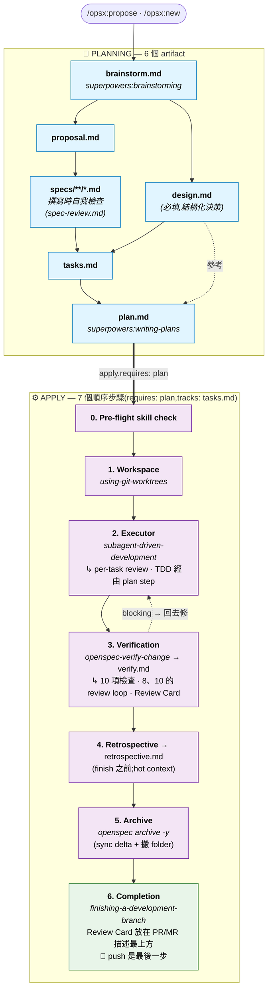

# superpowers-bridge Schema

[English](./README.md) · [繁體中文](./README.zh-TW.md) · [Tiếng Việt](./README.vi-VN.md)

> **社群維護的翻譯**:本頁由社群貢獻並維護,可能落後於 [`README.md`](./README.md)。兩者不一致時,以英文版為準。
> *Community-maintained translation — it may lag behind [`README.md`](./README.md). Where the two disagree, the English version is authoritative.*

[](https://github.com/AdrianTheopold/openspec-schemas/actions/workflows/validate-schemas.yml)
[](#相容性)
[](#相容性)

> 把 [OpenSpec](https://github.com/Fission-AI/OpenSpec) 的 artifact 治理流程(**做什麼**)與 [obra/superpowers](https://github.com/obra/superpowers) 的執行技能(**怎麼做**)整合為單一工作流。額外提供 evidence-first 的 `retrospective` artifact,補上 Superpowers 沒有的 retro 能力。
>
> 整合**完全發生在 prompt 層**——不修改 Superpowers 任何程式碼,不修改 OpenSpec CLI。Schema 版本:v1。
>
> 本 repo 是 [JiangWay/openspec-schemas](https://github.com/JiangWay/openspec-schemas) 的 **fork**(upstream commit `f5d4040`),自 2026-07-02 起作為實際維護的 working fork 獨立維護(upstream 已停止維護);會依需要自由分歧,不以回饋 upstream PR 為目標。

---

## 安裝

### 方法 1:Claude Code 一鍵 prompt(推薦)

在你專案的根目錄打開 Claude Code,把下面這段貼進去:

```
Install the superpowers-bridge schema for OpenSpec into this project:

1. Verify the project has an `openspec/` directory (run `openspec init` if missing).
2. Clone https://github.com/AdrianTheopold/openspec-schemas to a temp dir.
3. Copy the `superpowers-bridge/` subdirectory to `openspec/schemas/superpowers-bridge/`.
4. Run `openspec schema validate superpowers-bridge` to verify.
5. Run `openspec schemas` and confirm `superpowers-bridge` is listed.
6. If a CLAUDE.md exists at the project root, ask me whether to insert the workflow-routing fragment from `openspec/schemas/superpowers-bridge/templates/adopters/CLAUDE.md.fragment.<locale>.md` (auto-detect locale from existing CLAUDE.md content; default zh-TW for Traditional Chinese, no suffix for English). If I say yes, append the fragment as a new section. If no CLAUDE.md exists, skip.
7. Clean up the temp directory.
8. Verify Superpowers plugin is installed by running `claude plugin list`.
   If not listed, run `claude plugin install superpowers@claude-plugins-official`.
9. Show me the final state.
```

### 方法 2:手動 bash(CI / 非 Claude 環境)

```bash
git clone https://github.com/AdrianTheopold/openspec-schemas /tmp/oss
cp -R /tmp/oss/superpowers-bridge ~/your-project/openspec/schemas/superpowers-bridge

# 可選:把 workflow-routing fragment 插進 CLAUDE.md
# cat /tmp/oss/superpowers-bridge/templates/adopters/CLAUDE.md.fragment.md      # 英文
# cat /tmp/oss/superpowers-bridge/templates/adopters/CLAUDE.md.fragment.zh-TW.md  # 繁中

rm -rf /tmp/oss
cd ~/your-project
openspec schema validate superpowers-bridge
claude plugin install superpowers@claude-plugins-official  # 若尚未安裝
```

---

## 升級已採用本 schema 的專案

如果你的專案早已在 `openspec/schemas/superpowers-bridge/` 安裝過本 schema,想拿到最新版本,執行下列其中一種升級方式。升級會整個覆蓋 `superpowers-bridge/` 目錄,並提供 CLAUDE.md 片段更新 — 詳情見下方「升級會【覆蓋】什麼?」。

### 升級方法 1:Claude Code 一鍵 prompt(推薦)

在你專案的根目錄打開 Claude Code,把下面這段貼進去:

```
Upgrade the superpowers-bridge schema in this project:

1. Verify `openspec/schemas/superpowers-bridge/` already exists (upgrade, not fresh install). If missing, abort and tell me to use the install instructions instead.
2. Clone https://github.com/AdrianTheopold/openspec-schemas to a temp dir.
3. Show me the diff between the local `openspec/schemas/superpowers-bridge/` and the cloned `superpowers-bridge/` (use `diff -ruN`). Wait for my ack before overwriting.
4. After my ack, overwrite the local schema dir with the cloned one.
5. Run `openspec schema validate superpowers-bridge` to verify.
6. Check whether this project has `CLAUDE.md` at the repo root.
   - If yes: scan it for an existing workflow-routing section referencing superpowers-bridge.
     - If found: show me the diff between that section and `superpowers-bridge/templates/adopters/CLAUDE.md.fragment.<locale>.md`. Wait for my ack before replacing.
     - If not found: ask whether to insert the new fragment from `templates/adopters/CLAUDE.md.fragment.<locale>.md`.
   - If no CLAUDE.md exists: skip.
7. Clean up the temp directory.
8. Show me the final state.
```

> `<locale>` 預設 `zh-TW`(若你 CLAUDE.md 是繁中)或省略(英文)。Claude 會依你 CLAUDE.md 的既有語言判斷。

### 升級方法 2:手動 bash

```bash
# 1. 取最新的 bundle
git clone https://github.com/AdrianTheopold/openspec-schemas /tmp/oss-upgrade

# 2. 先看差異(不直接覆蓋)
diff -ruN ~/your-project/openspec/schemas/superpowers-bridge /tmp/oss-upgrade/superpowers-bridge

# 3. 確認 diff 後再覆蓋
rm -rf ~/your-project/openspec/schemas/superpowers-bridge
cp -R /tmp/oss-upgrade/superpowers-bridge ~/your-project/openspec/schemas/superpowers-bridge

# 4. 驗證
cd ~/your-project && openspec schema validate superpowers-bridge

# 5. CLAUDE.md fragment(手動處理)
# 看 /tmp/oss-upgrade/superpowers-bridge/templates/adopters/CLAUDE.md.fragment.zh-TW.md
# 比對自己 CLAUDE.md 是否要插入或更新對應段落

# 6. 清理
rm -rf /tmp/oss-upgrade
```

### 升級會【覆蓋】什麼?

| 路徑 | 行為 | 是否需手動 |
|---|---|---|
| `openspec/schemas/superpowers-bridge/` | 自動整個目錄覆蓋 — 從 upstream 整包換新(Method 2 是 `rm -rf` + `cp -R`,Method 1 等價) | 不需 |
| `CLAUDE.md`(專案根) | schema 目錄附 `templates/adopters/CLAUDE.md.fragment.<locale>.md` 片段;升級流程會把你的 CLAUDE.md 跟此片段 diff 給你看,等你 ack 才插入或更新 | 需要 — 確認 diff,選擇插入 / 取代 / 保留現有 |

> bridge 目錄是 monolithic — 要嘛整包換新版,要嘛留舊版,**沒有逐檔 opt-in**。CLAUDE.md 是升級流程唯一會碰專案根目錄的檔案,而且永遠等你 ack。

> In-flight change(任一 phase:brainstorm / design / specs / ...)仍合法 — schema graph(`requires:` edges、PRECHECKs、artifact 依賴)在 v1.x 沒有變動。升級前產出的 `verify.md` / `retrospective.md` 仍可讀;若對它們重跑 `/opsx:verify` 或 `/opsx:continue → retrospective`,會用新 template 結構覆蓋。

> 未來若 schema graph 結構性變動(增刪 artifact、改 `requires:` edges、PRECHECK 變動),會在 README 上方加版本欄位 + 提供 migration guide;v1 → v1.x 純 instruction prose 改動安全,不需 migration。

---

## 這個 schema 解決什麼問題?

OpenSpec 管 **「做什麼」**(artifact 生命週期:proposal / specs / tasks / verify 等)。Superpowers 管 **「怎麼做」**(執行紀律:brainstorming、writing-plans、TDD、code review)。各自堅實,但實際開發中交替使用會出現三個結構性問題:

1. **產出重複** — brainstorming 寫設計到 `docs/superpowers/specs/`,OpenSpec 又在 change 目錄重寫 `proposal.md` / `design.md`,內容高度重疊。
2. **Task 分裂** — OpenSpec 的 `tasks.md`(粗粒度 checkbox)和 Superpowers 的 `plan.md`(TDD micro-step)描述同一件事,但格式、位置、追蹤各自獨立。
3. **手動編排** — 使用者要自己判斷現在該用哪個 skill,兩個系統不會自己銜接。

### 為什麼用自定義 schema 而非修改現有 skill?

兩個替代方案被排除:

- **在 `config.yaml` 加自定義欄位**(例如 `skill_bindings`):OpenSpec CLI 不認識這些欄位,沒有驗證、沒有發現性,且需要修改多個 SKILL.md 才能讀取。
- **直接修改 opsx skill 檔**:侵入性高(影響每個 change),且 SKILL.md 升版時會被覆蓋。

自定義 schema 用的是 OpenSpec **原生支援的專案級 schema 機制**:CLI 驗證結構、`openspec schemas` 自動列出、每個 change 獨立選擇 schema(`--schema spec-driven` 或 `--schema superpowers-bridge`)、不修改任何現有 SKILL.md 或 command 檔案。

---

## 進入與離開的判斷(Entry & exit gates)

本 schema 的 instruction 只在 `/opsx:*` 指令啟動 artifact 時才注入 prompt。如果你以 narrative 方式觸發 Superpowers skill(例如直接對 Claude 說「我們討論一下架構」),預設行為會繞過本 schema —— brainstorming 仍會寫到 `docs/superpowers/specs/`,讓整合的 redirection 完全失效。

這一段告訴你三件事:

1. 何時根本不需要進入本 schema(直接 PR 即可)
2. 已經在 verbal brainstorm,何時該升級成 opsx change
3. 進入本 schema 時要避開的 front-door 反模式

### 何時不進入本 schema(直接 PR)

並非每個改動都要走 change 流程。下列情境**不需要**建 change:

| 情境 | 是否要建 change | 怎麼做 |
|---|---|---|
| 新功能 / 新 capability | ✅ 要 | `/opsx:new <name> --schema superpowers-bridge` |
| Breaking change | ✅ 要 | 同上 |
| 架構變更 | ✅ 要 | 同上 |
| Bug fix(恢復原本行為,不變更合約) | ❌ 不要 | 直接 PR |
| 測試補寫 / 覆蓋率 | ❌ 不要 | 直接 PR |
| 建置工具微調(linter 規則、覆蓋率門檻等) | ❌ 不要 | 直接 PR |
| 非破壞性依賴升級 | ❌ 不要 | 直接 PR |
| 文件更新 / typo 修正 | ❌ 不要 | 直接 PR |
| Config 值微調(不動結構) | ❌ 不要 | 直接 PR |

> 原則:**流程儀式跟風險成正比**。動到對外合約、跨系統介接、DB schema、合規邊界 → 走 change;改 typo、抓 bug、調 timeout 數字 → 直接 PR。模糊地帶用下方 5 條 checklist 自我檢驗。

### 進行中的 verbal brainstorm 何時升級成 change

如果使用者以 narrative(「我們來討論架構」「腦力激盪一下」)觸發了 `superpowers:brainstorming`,brainstorming 的產出**不可以**寫到 `docs/superpowers/specs/` —— 那會繞過本 schema 的 output redirection,在 repo 裡留下 orphan artifact。

正確流程:在以下 5 條判準**全部滿足**之前,維持 verbal brainstorm;全滿足時升級到 `/opsx:propose` 或 `/opsx:new`,讓 brainstorming 的對話結論落到 `openspec/changes/<name>/brainstorm.md`。

1. **Scope 鎖定** —— 一句話講清「包含什麼、不包含什麼」,且不會在每一輪對話又長出新項目
2. **主要設計分歧已收斂** —— 替代方案討論過、選了一個;剩下的 unknown 是**明確列出的 TBD**(有 owner、有影響面),不是「還沒想到」
3. **跨系統依賴盤點過** —— 對方就緒 / 暫 mock 替代 / 真未知,三選一講得清
4. **驗收條件可陳述** —— 能列出「這個 change 做完的判準」(例:`./mvnw clean verify` 通過 + N 個具體成果)
5. **對話進入收斂** —— 最近 1-2 輪沒有「啊還有另一種做法是...」這種 fork

任一條缺 → 繼續 brainstorm。全滿足 →:
- LLM **應主動建議** 「看起來條件齊了,要不要開 `/opsx:propose`?」
- 使用者**也可主動講** 「把這個開成 change 吧」
- 不論誰先提,**升級都需人類 ack**,不會自動觸發

### Front-door 反模式

| 反模式 | 為什麼錯 |
|---|---|
| schema 已安裝後仍讓 brainstorming 寫到 `docs/superpowers/specs/` | 繞過 [schema.yaml](./schema.yaml) 中 **brainstorm** artifact instruction 的 `IMPORTANT output redirection` 段,留下 orphan artifact。verify §6 會偵測到 |
| 讓 writing-plans 寫到 `docs/superpowers/plans/` | 同理 —— 對應的是 **plan** artifact instruction 裡的同一段。verify §6 會偵測到 |
| TBD 還沒收斂就升級到 opsx | 那些 TBD 在 apply phase 一樣會擋住進度,只是把問題往後挪 |
| 對 bug fix / typo 也建 change | 流程儀式 > 實質風險,反而拖慢交付 |

---

## 工作流與整合點

### Artifact DAG

```text
brainstorm ──┬──→ proposal ──→ specs ──┐
             │                         ├──→ tasks ──→ plan ──→ [apply] ──→ verify ──→ retrospective
             └──→ design ──────────────┘
```

與 `spec-driven` 的差異:

| | spec-driven | superpowers-bridge |
|---|---|---|
| 起點 | proposal(手動撰寫) | **brainstorm**(調用 brainstorming skill) |
| Plan 層級 | tasks(粗粒度) | tasks + **plan**(TDD micro-step) |
| apply 需要 | tasks | **plan** |
| apply 方式 | 標準 task-by-task | **worktree + subagent-driven-development**(per-task review;TDD 經由 plan 的 test-first step) |
| Post-apply | (無) | **verify**(10 項檢查)+ **retrospective** artifacts |
| Review | (無) | 撰寫時與 verify 中的 **spec review**;verify 中的 **security pass**;findings 由 agent 自己清掉;PR/MR 上附一張 **review card** |
| 新增 artifacts | — | brainstorm, plan, verify, retrospective |

### Lifecycle(apply 編排 + 時序註記)

上方 Artifact DAG 顯示**檔案存在**依賴。下面這張完整 lifecycle 加上 apply phase 的順序步驟,以及 graph 邊與實際產出時序的**錯位**。



ASCII 簡圖(CLI 可讀):

```text
PLANNING ━━━━━━━━━━━━━━━━━━━━━━━━━━━━━━━━━━━━━━━━━━━━━━━━━━━━━━
  brainstorm.md ──┬─→ proposal.md ──→ specs/**/*.md ──┐
                  │                                   ├─→ tasks.md ──→ plan.md
                  └─→ design.md(必填)────────────────┘
                         (撰寫時 spec 自我檢查)                         │
                          apply.requires: [plan], apply.tracks: tasks  ▼
APPLY ━━━━━━━━━━━━━━━━━━━━━━━━━━━━━━━━━━━━━━━━━━━━━━━━━━━━━━━━
  0. Pre-flight skill check
  1. superpowers:using-git-worktrees
  2. superpowers:subagent-driven-development(+ per-task review;TDD 經由 plan step)
  3. openspec-verify-change → verify.md(10 項檢查,Review Card) ◄┐
                              │                                 │ blocking → 回去修
                              ▼                                 │
  4. retrospective.md(finish 之前;hot context)
  5. openspec archive -y(sync delta + 搬 folder)
  6. superpowers:finishing-a-development-branch(Review Card 放在 PR/MR 描述;🏁 push 是最後一步)
```

流程中有兩個 review 點,都在 PR/MR 出現之前。第一個是**撰寫時的 spec review**:`templates/spec.md` 裡的一則註記要求撰寫 agent 在完成 delta spec 之前,先對照 [spec-review.md](./spec-review.md) 自我檢查。第二個在 verify:**檢查 8** 以 fresh subagent 執行同一份規則檔,**檢查 9** 回報 change 偏離 adopter 所指定 governing sources 的每個地方,**檢查 10** 審查 diff 中的安全缺陷。檢查 8 與 10 的 findings 由 agent 自己清掉;人類只在 merge 時讀一份產物,也就是 review card。

> **時序註記**(完整理由見下方「設計觸點 #6」):
> - `verify.md` 在 graph 上宣告 `requires: plan`,但實際產在 apply step 3 內。
> - `retrospective.md` 宣告 `requires: verify`,並依 Step 4 在 PR 開啟**之前**產出 —— PR diff 才會包含完整 archived cycle(所有 artifact 完成、spec 已 sync、change folder 在 `archive/`)。
> - 檢查 8 與 10 在 findings 清除前會擋住 verify,所以擋在 steps 4–5 之前的那個 PASS,要等 review loop 跑完才會出現(見「六個值得記住的設計觸點」#6)。
> - `requires:` 邊是給 OpenSpec graph 引擎用的「檔案存在」依賴;runtime 順序由 instruction prose 控制。

### 七個 Superpowers 觸點

| # | Superpowers skill | 掛在哪 | 觸發方式 |
|---|---|---|---|
| 1 | `superpowers:brainstorming` | `brainstorm` artifact instruction | 直接(含 PRECHECK) |
| 2 | `superpowers:writing-plans` | `plan` artifact instruction | 直接(含 PRECHECK) |
| 3 | `superpowers:using-git-worktrees` | apply step 1 | 直接 |
| 4 | `superpowers:subagent-driven-development` | apply step 2 | 直接 |
| 5 | `superpowers:test-driven-development` | (#4 內部經由 plan 的 test-first step 遵循) | **經由 plan** |
| 6 | `superpowers:requesting-code-review` | (其 reviewer prompt 執行 #4 的 final review) | **傳遞** |
| 7 | `superpowers:finishing-a-development-branch` | apply step 6 | 直接 |

加上一個 OpenSpec built-in:`openspec-verify-change`(apply step 3,產出 `verify.md`)。

> **不支援 `executing-plans` fallback**。本 schema 是 opinionated 的:要求 subagent-capable 平台(Claude Code、Codex 等)。替代 executor `superpowers:executing-plans` 在同一個 context 裡自己實作每個 task,每個 task 都沒有 reviewer(已對其 [SKILL.md](https://github.com/obra/superpowers/blob/v7.0.0/skills/executing-plans/SKILL.md) 做事實查核)。自 Superpowers 6.4.1 起它確實會載入 TDD 與 verification-before-completion,並以一次 fresh 的整個 branch review 結尾,但它放棄了每個 task 的 fresh context 與 per-task review 關卡 —— 正是本 schema apply 階段的基礎,退到 executing-plans 等於靜默丟掉它們。若你的平台沒有 subagent 支援,改用 OpenSpec 內建的 `spec-driven` schema。

### Output redirection(產出重導)

Superpowers skill 有預設輸出路徑(例如 brainstorming 寫到 `docs/superpowers/specs/`)。本 schema 的 artifact instruction **覆寫**這個行為,透過 prompt 上下文注入,把產出重導到 change 目錄:

- brainstorming → `openspec/changes/<name>/brainstorm.md`
- writing-plans → `openspec/changes/<name>/plan.md`

純粹透過 invocation-time 上下文注入實現,不修改 skill 源碼。

---

## 使用方式

### 快速流程(推薦)
```bash
/opsx:ff my-feature    # 一條龍:scaffold + brainstorm + proposal + design + specs + tasks + plan
/opsx:apply            # worktree + subagent-driven-development(per-task review;TDD 經由 plan step)
/opsx:verify           # 產出 verify.md(10 項檢查)與其 Review Card
/opsx:continue         # → retrospective(產出 retrospective.md,§0 + 6 sections)
/opsx:archive          # 封存
```

### 逐步流程
```bash
/opsx:new my-feature --schema superpowers-bridge
/opsx:continue         # → brainstorm(互動式對話)
/opsx:continue         # → proposal
/opsx:continue         # → design(將 brainstorm 重組為結構化決策)
/opsx:continue         # → specs
/opsx:continue         # → tasks
/opsx:continue         # → plan
/opsx:apply            # → 實作 + worktree + subagent-driven-development
/opsx:verify           # → verify.md(post-apply,跑 10 項檢查並填寫 Review Card)
/opsx:continue         # → retrospective.md(post-verify,evidence-first §0 + 6 sections)
/opsx:archive
```

> **Profile 註記 —— 本 bridge 的 opsx 流程需要 OpenSpec 的擴充(expanded)workflow profile。** 核心(core)profile(`openspec init` 的預設)只提供 `propose, explore, apply, sync, archive`;擴充專屬的指令是 `new, continue, ff, verify, bulk-archive, onboard` —— 本 bridge 的流程從頭到尾都用到 `/opsx:continue`、`/opsx:ff`、`/opsx:verify`,不只 `/opsx:new`。啟用擴充指令請執行 `openspec config profile`(在互動選單選取完整 workflow 集)再跑 `openspec update`;單獨跑 `openspec update` **不會**切換 profile。若必須留在 core,只有第一步有 CLI 等效指令(`openspec new change <name> --schema superpowers-bridge`)—— `/opsx:continue`/`/opsx:verify` 沒有等效,因此實務上必須啟用擴充 profile。(`/opsx:new` 是唯一接受 `--schema` 的建立指令;`/opsx:propose` 與 `/opsx:ff` 使用專案的預設 schema。)

### 切回 spec-driven
```bash
# 單一 change 用不同 schema
/opsx:new my-simple-fix --schema spec-driven

# 或修改專案預設(openspec/config.yaml: schema: spec-driven)
```

---

## Apply phase 詳細步驟

`/opsx:apply` 會觸發 [schema.yaml](./schema.yaml) `apply.instruction` 中的步驟:

#### 0. Pre-flight — 驗證必要的 Superpowers skill

確認以下 skill 都安裝才繼續:

- `superpowers:using-git-worktrees`
- `superpowers:subagent-driven-development`
- `superpowers:test-driven-development`(經由 plan 的 test-first step 遵循;SDD 本身不載入它)
- `superpowers:requesting-code-review`(其 reviewer prompt 執行 SDD 最後的整個 branch review)
- `superpowers:finishing-a-development-branch`

skill 缺失 → STOP 並通知使用者,不靜默 fallback,本 schema 內也沒有 manual mode。建議使用者在那個 change 改用 OpenSpec 內建的 `spec-driven` schema,或安裝缺失的 skill 後重來。

> 本 schema 的 v0 版本曾在這裡放「自動 commit change artifacts 到當前分支」邏輯,在 [PR #970 review](https://github.com/Fission-AI/OpenSpec/pull/970) 後移除:處理未追蹤的 change 目錄是 worktree skill 的責任,schema 不該主動改寫使用者的 git history。

#### 1. Workspace — `superpowers:using-git-worktrees`

建立 `.worktrees/<change-name>/`、切到新 branch、跑專案 setup、確認 test baseline 乾淨。

#### 2. Executor — `superpowers:subagent-driven-development`

Main agent 讀 `plan.md`,為每個 micro-task 派發 fresh subagent:

- **TDD**(`superpowers:test-driven-development`):經由 plan 而非 SDD 進到每個 task —— plan artifact 要求每個有行為的 task 以「寫失敗測試」與「執行、預期它 fail」開頭,而 SDD 的 implementer 寫測試時「following TDD if task says to」,並回報 RED 與 GREEN 證據,由 task reviewer 檢視
- **per-task review**:每個 task 完成後由 controller 派發 subagent-driven-development 自己的 merged task-reviewer(spec compliance + code quality)—— 不是另外呼叫一個 skill;Critical 級問題擋下進度

每份 brief 都帶有 plan.md 的 Global Constraints,其中包含註解規則、commit trailer 規則與 adopter 的安全規則。在任何一條這些規則、或 adopter 的 apply guidance 保留給人類的動作之前,controller 都要停下來問人類,這是 Superpowers 自己 stop classes 之外的額外規則;沒有安全規則也沒有 apply guidance 時,那些 stop classes 就是全部的 stop 規則。見[設定 key](#設定-key)。

task 清掉時,兩份進 git 的 ledger 都要更新 —— `tasks.md` 的粗粒度 checkbox,以及該 task 在 `plan.md` 的 step box —— 和 SDD progress ledger 那一行寫在同一個 bookkeeping 步驟裡。若某個 step 是被延後而非完成,當下就在 `plan.md` 標成 `[~]`,因為 verify §7 讀的正是這個標記。所有 task 跑完後,對整個 branch 再做一次 final code review(`superpowers:requesting-code-review`)。

本 schema **不支援** `superpowers:executing-plans` 作為 fallback。理由見下方「六個值得記住的設計觸點」段。

#### 3. Verification — `openspec-verify-change`

產出 `verify.md`,跑 10 項檢查:

1. 結構驗證(`openspec validate --all --json`)
2. task 完成度
3. delta-spec sync 狀態
4. design/specs 一致性(non-blocking warning)
5. 實作信號(commit 狀態)
6. front-door routing leak detector(non-blocking warning)
7. deferred-dogfood vs automated-test 等價性 —— 僅在 `plan.md` 有 `[~]` 但等價性章節空白(gap 分析被跳過)時才 block,其他情境屬 informational
8. **spec review** —— fresh subagent 對 delta specs 執行 [spec-review.md](./spec-review.md):涵蓋 `openspec validate --strict` 沒檢查的規則,讓進入 `openspec/specs/` 的文字合併後仍然讀得通。Findings 會擋住 verify,直到 agent 修掉或附上紀錄的理由駁回;連續三次有 findings 的執行之後,下一次只審查上次之後改動的部分,仍未解決的項目交給 review card。乾淨的一次回報 `No findings.`
9. **deviation report** —— fresh subagent 讀取 adopter 指定的 governing sources(取其 trunk 所持有的版本,絕不取自正在修改它們的 branch)、change 的 artifacts 與 diff,回報 change 牴觸、捨棄或超出 source 的每個地方,各附原因、推理錯誤時的代價,以及對 source 的建議修改。Deviation 不會讓 verify 失敗:接受它、修改 source 或把程式改回去,是人類在 merge 時的決定。缺少報告、deviation 沒有原因、或 source 讀不到,則會讓它失敗。乾淨的一次回報 `No deviations from the governing sources.`;沒有設定任何 source 時,記下 `No governing sources configured` 並通過
10. **security pass** —— 在 fresh context 中審查 change 對照其 merge 目標 branch 的 diff 是否有安全缺陷;由 fresh subagent 執行:runtime 自帶安全審查時就用它(Claude Code 中是 `/security-review`),否則、或該審查涵蓋的範圍不及 diff 時,改用固定的 reading list。Agent 逐項修掉或附理由駁回;若修正會改變某個 governing source 所陳述的行為,該項就成為交給檢查 9 的 deviation

失敗會回到對應 artifact 修正後重跑 verify。沒有 blocking 問題之後,controller 填寫 `verify.md` 的 `## Review Card` 區段:**Deviations**(檢查 9 的報告)與 **What the checks did not cover**(diff 觸及的 sensitive areas、沒跑或走 fallback 路徑的檢查、仍未解決的 findings)是要讀的兩部分;**Evidence**、**Security pass**、**How to revert**、**Rulings** 只需瀏覽。Card 是 `verify.md` 的一個檢視,`verify.md` 仍是紀錄,step 6 會把它放在 PR/MR 描述的最上方。

> **Steps 4–6 是 verify 後的 canonical 順序:retro → archive → PR。順序顛倒會產出不完整的 PR(retrospective 跟 archive 變成 merge 後才補的 trailing commits,失去 hot context)。**

#### 4. Retrospective — `retrospective` artifact(建議,依 Entry & exit gates 的 skip 規則 trivial fix 可跳)

Evidence-first 反思:§0 Evidence(量化前置數據 —— commit 數、diff 大小、tasks done 比例、新依賴、validate 狀態等)加上 6 段分析(Wins / Misses / Plan deviations / Skill compliance / Surprises / Promote candidates)。每個 claim 引用 commit / file / 可量化事實,通常指向 §0 而非每行 inline 證據。procedure 直接內嵌在 artifact instruction —— 不依賴外部 skill(Decision 3 in 設計 spec:Claude Code plugin 化延後到 v1.x)。

在 finish/push **之前**寫好,讓 retro 跟其他 artifact 一起落在同一個 PR diff。

#### 5. Archive — `openspec archive -y`(或 `/opsx:archive`)

把 delta spec sync 到 `openspec/specs/<capability>/spec.md`、把 change 目錄搬到 `openspec/changes/archive/YYYY-MM-DD-<name>/`。在 finish/push **之前**跑完,這樣 PR diff 反映完整的 archived cycle 狀態(所有 artifact 完成、spec 已 sync、folder 在 `archive/`)。

#### 6. Completion — `superpowers:finishing-a-development-branch`

確認 tests 全綠、呈現 merge / PR / keep-branch / discard 選項。`verify.md` 的 Review Card 放在 PR/MR 描述最上方(若 request 建立時沒帶上,事後再編輯補進);card 未填寫時要 STOP,不能略過。本 bundle 自己不會貼 inline review comment。worktree 只在 merge 或 discard 選項時清理;push/PR 路徑會保留它,方便你依 PR feedback 迭代。**PR 是最後一步** —— 若 retro 或 archive 還沒跑,先補完。

---

## 設定 key

本 bundle 不放任何 adopter 的內容。Adopter 的 governing sources、deviation 門檻與安全規則留在它自己的來源,`openspec/config.yaml`(OpenSpec 的專案設定)只負責**指向**它們:寫明規則集放在哪、怎麼載入(檔案路徑、URL 或指令),絕不放副本,所以規則只需在一處修改,也不用發新的 bundle release。Bundle 讀取四個 key:

| Key | 隨附於 | bundle 怎麼用 |
|---|---|---|
| `context` | 每個 artifact 的 instructions | 指明 governing sources 以及如何讀取。檢查 9 讀取 adopter 已接受的版本(它的 trunk),絕不取自正在修改它們的 branch,並記下每個 source 讀取時的 review status。 |
| `rules.verify` | verify artifact 的 instructions | 收窄或放寬檢查 9 對 deviation 的認定(預設:change 牴觸、捨棄或超出 source 所陳述的內容,明列的 non-goal 也算),說明建議的修改如何送達它的 source,並列出 diff 觸及時 review card 要列出的 sensitive areas。 |
| `rules.plan` | plan artifact 的 instructions | 安全規則,或指向它們所在之處的 pointer。Plan instruction 會把它們以原樣(規則本身或 pointer)放進 `plan.md` 的 Global Constraints(若是 pointer,則要求每個 implementer 在第一個動作前先載入規則),因此它們能送達每份 implementer brief 與 task reviewer。 |
| `operations.apply.guidance` | apply 的 instructions(`openspec instructions apply --json` 回傳的 `operationGuidance` 欄位) | controller 在 apply 期間必須遵守的事項,例如哪些動作要先停下來問。會加進 controller 派發的每份 brief。 |

最小範例,使用中性的 `orders` 領域:

```yaml
schema: superpowers-bridge
context: |
  Governing sources: orders-direction.md in the repository at <path>.
  Read it at that repository's trunk with `git -C <path> show main:orders-direction.md`,
  never from its working tree.
rules:
  verify:
    - "Sensitive areas: CI configuration (.github/workflows/)."
```

沒有這些 key 時,bundle 的行為與以前相同:檢查 9 記下 `No governing sources configured` 並通過,review card 不列 sensitive areas,Global Constraints 只帶 bundle 自己的註解規則與 commit trailer 規則,Superpowers 的四個 stop classes 就是全部的 stop 規則。

針對程式碼內容的規則(不得出現 secret 值、不得停用憑證檢查),用確定性的 per-edit 檢查來執行比靠 brief 更好:例如 runtime 在每次編輯時執行的 pattern hook,主 session 與 subagent 都適用。採用哪種檢查(若有)屬於 adopter 的設定,不屬於 bundle 的內容。

---

## CLI cheat sheet

| 情境 | 指令 |
|---|---|
| 新 change(互動式) | `/opsx:new <name> --schema superpowers-bridge` 接著多次 `/opsx:continue` |
| 新 change(一鍵) | `/opsx:ff <name>` |
| 恢復中斷的 change | `/opsx:continue <name>` |
| 進入實作 | `/opsx:apply <name>` |
| 手動 verify | `/opsx:verify <name>` |
| 歸檔 | `/opsx:archive <name>` |
| 用內建(跳過 brainstorm) | `/opsx:new <name> --schema spec-driven` |
| 列出所有 schema | `openspec schemas` |
| 查看某 change 進度 | `openspec status --change <name> --json` |
| 列出 active changes | `openspec list` |
| 全專案驗證 | `openspec validate --all --json` |

---

## 六個值得記住的設計觸點

### 1. Skill-name PRECHECK(Layer 1 capability detection)

每個 invoke Superpowers skill 的 artifact / apply step 在 instruction 開頭跑 PRECHECK,確認 skill 真的存在於 LLM 的 available skills list。**缺失就 STOP,不靜默 fallback**。這是 [PR #970 review](https://github.com/Fission-AI/OpenSpec/pull/970) 顧慮 #1 第 1 層的具體應對 —— fail loud, fail early。

### 2. Schema-level vs prompt-level 整合

整合**完全**發生在 `instruction:` 欄位(純 prompt)。Superpowers 升版某個 skill 的行為時,本 schema 不用改。只有 skill 被改名或移除時才要 touch `schema.yaml`。

### 3. TDD 與 code review 的來源顯式化

code review 發生在 `subagent-driven-development` 內部:每個 task 之後由它自己的合併 task reviewer 審查,最後的整個 branch review 則用 `requesting-code-review` 的 reviewer prompt。TDD 則不是:自 Superpowers 6.2.0 起 SDD 的 SKILL.md 就沒有提到 `test-driven-development`,它的 implementer 只在 task 要求時才遵循 TDD。因此 plan artifact 要求每個有行為的 task 都有 test-first step,apply step 2 的 instruction **直接寫明**兩者各自的來源,讓讀者一眼看懂「apply 階段到底會發生什麼」—— 以及為什麼 `plan.md` 交給 executor 時 test-first step 必須完整保留。

### 4. Opinionated:只支援 subagent 平台,沒有手動 fallback

本 schema 要求 subagent-capable 平台(Claude Code、Codex 等)。替代 executor `superpowers:executing-plans` 在 Superpowers 6.4.1 重寫:現在在 Task 1 之前必須載入 `test-driven-development`,每個 task 的完成宣告受 `verification-before-completion` 約束,最後用 `requesting-code-review` 的 reviewer prompt 對整個 branch 做一次 fresh context review(已對其 [SKILL.md](https://github.com/obra/superpowers/blob/v7.0.0/skills/executing-plans/SKILL.md) 做事實查核)。它仍然不做的,正是本 schema apply 階段的基礎:所有 task 都在 executor 自己的 context 裡跑 ——「no implementer subagent per task, no reviewer per task」—— 因此每個 task 沒有 fresh context,下一個 task 開始前也沒有 per-task review 關卡(spec compliance + code quality)。退到它等於靜默丟掉這道關卡。我們選擇在 Step 0 fail loud,並指引使用者改用內建的 `spec-driven` schema。

### 5. Evidence-based PRECHECK for verify and retrospective(Layer 2 capability detection)

時序敏感的 artifact 在 instruction 開頭跑具體 shell 證據檢查:

- **verify**:`git log <base>..HEAD | wc -l > 0` 且 `grep -cE '^\s*([-*+]|[0-9]{1,9}[.)])\s*\[\s*[xX]\s*\]([^([]|$)' tasks.md > 0` 且 `grep -cE '^\s*([-*+]|[0-9]{1,9}[.)])\s*\[\s*[xX~]\s*\]([^([]|$)' plan.md > 0`
- **retrospective**:`test -f verify.md` 且 `! grep -q '^- \[x\] ❌ FAIL' verify.md`

LLM 不必解讀 timing 文字 —— 跑指令、看結果即可。這是顧慮 #1 第 2 層,以及顧慮 #2 的緩解。

### 6. verify 與 retrospective 是時序錯位的 artifact(已知限制)

`verify.requires: [plan]` 與 `retrospective.requires: [verify]` 在 schema graph 上是「檔案存在」依賴,但兩者的 instruction 都明寫「MUST run AFTER apply phase / verify pass」。這是刻意錯位 —— OpenSpec 引擎只看前置 artifact 檔案存在,不會檢查 apply 是否真的跑完、verify 是否真的 pass。引擎原生的修法等 OpenSpec 引入 `post_apply` phase(對應 spec-kit 的 `after_implement` hook);上述第 5 點 evidence-based PRECHECK 是 v1 的緩解。

自 1.5.0 起,這個錯位更明顯,因為檢查 8 與 10 會 block:verify 在 apply step 3 內成為一個迴圈(找出問題、透過 implementer subagent 修正、commit、重跑),不再是一次性的檢查,而且每次執行都會記下它審查的 commit,下一次執行與 capped run 才知道自己的 base。Verify 的 PRECHECK 仍然只讀可觀察的狀態(commit、已勾選的 box)。Capped run 之後仍未解決的 finding 不會讓 verify 卡在 FAIL:它把 Overall Decision 設為 PASS WITH WARNINGS 並交給 review card,因此後面的 retrospective 與 archive 不會被 agent 清不掉的 finding 擋住。Review card 在 archive 之前就和 `verify.md` 一起 commit,所以會隨 archived change 進入 PR/MR 的 diff。

---

## 版本識別

本 bundle 帶**兩組版本號**,意義不同,不要混淆:

| 標識 | 位置 | 含義 | 範例 |
|---|---|---|---|
| Schema major | `schema.yaml: version: 1` | schema graph 契約版本(artifacts、`requires:` 邊、PRECHECK 形狀)。破壞性改動才 bump | `1` |
| Bundle release | `VERSION` 檔 + git tag | 此 bundle 的 SemVer 發佈版本,從屬於某個 schema major | `1.0.0`(tag `v1.0.0`) |

`1.x.y` 是 schema major `v1` 的一個 published cut;未來 schema major `v2` 會把 bundle release 重新從 `2.0.0` 起算。Adopter 釘到 `v1.x.y` 即享有 schema graph 在 v1 major 內的相容保證。

> 下方相容矩陣以 `v1`(schema major)為列鍵,因為 OpenSpec / Superpowers 的相容性由 schema 契約決定,不受 bundle 內部 patch 影響。

## 相容性

本 schema 撰寫時所對齊的 upstream 基準版本。這是**歷史快照,不是端對端相容性承諾** — CI 無法在 headless 環境跑完整的 prompt-layer workflow,行為相容性依賴 drift 觸發人類檢核。

目前 bundle release: **`1.5.0`**(見 [VERSION](./VERSION))。

| superpowers-bridge | OpenSpec CLI | Superpowers plugin | 基準日期 |
|---|---|---|---|
| v1 | `1.14.3` | `7.0.0` | 2026-10-21 |
| v1 | `1.13.0` | `6.3.0` | 2026-09-16 |
| v1 | `1.5.0` | `6.2.0` | 2026-08-12 |
| v1 | `1.5.0` | `6.1.0` | 2026-07-02 |

> Bundle **1.5.0** 沒有 schema graph 的變動(artifacts、`requires:` 邊與 PRECHECK 都相同),也沒有基準版本的調整;上表的基準仍然成立。它加入 `templates/spec.md` 中撰寫時的註記,為 verify 加入 spec review、deviation report 與 security pass,為 plan 加入 Global Constraints 規則,為 apply 加入 stop 規則、review loop 與 review card,並為 retrospective 加入駁回理由的統計。它的 acceptance suite `acceptance/superpowers-bridge/run.sh check` 在 CLI 上釘住各檢查所讀取的訊息文字(`Archive would refuse this delta`、`Purpose section is still a placeholder`、ADDED requirement 超過 500 字元時 `--strict` 的失敗、`proposal.md` 的 parse status),所以 CLI 某個 release 一旦改了措辭,是讓這次執行失敗,而不是悄悄讓某個檢查失去作用。
>
> 已對 **OpenSpec 1.14.3**(2026-10-21,bundle 1.4.1)重新對齊 OpenSpec 側。結構面:`openspec schema validate` 通過,每個 artifact 與 apply 的 instructions 都能產生,依 templates 撰寫的 probe change 通過 `openspec validate --strict`。從 1.14.3 `spec-driven` 文字吸收進四段繼承的 instruction:**proposal** —— 新 capability 以持久的系統行為命名,而非這個 change 的工作內容,邊界要內聚、不要包山包海;**specs** —— spec 檔一次寫一個,從第一個還沒有檔案的 capability 開始;每個 requirement 的描述不超過 500 字元,一個 requirement 一個行為(較長的 ADDED requirement 會讓 `--strict` 失敗),且絕不為了長度而在 MODIFIED 下刪減既有 requirement;新 capability 的 delta 第一個 section 是 `## Purpose`;**tasks** —— 只有內容為 `x` 的 checkbox 算完成(其他標記,包括 `[~]`,都視為未完成),不在追蹤進度內的工作以一般條列放在選用的 `## Workflow follow-up` 段落,每個 task group 自行交付自己該有的測試與文件。**design** upstream 未變。templates 加上 upstream 的 H1 標題,以及 capability 命名與長度規則。針對 bridge 的調整:`[~]` 延後標記只用在 `plan.md`;workflow follow-up 列的是 apply steps 3–6 —— 追蹤的 task 永遠不涵蓋 verify、retrospective、archive 或 finish,因為 verify 的 task-completion 檢查要求 `tasks.md` 每個 box 在 archive 前都已勾選。原樣保留:brainstorm-first 的框架、spec 盤點段落、MODIFIED 完整性段落(upstream 沒有對應)、`tasks.md` / `plan.md` 的 ledger 分工。與 1.4.0 一樣刻意不納入:`--store` 參數(stores 仍未使用)。
>
> 已對 **Superpowers 7.0.0**(2026-10-21,bundle 1.4.1)以完整 v6.4.2→v7.0.0 skill diff 重新核對,已安裝版本與 upstream tag 完全一致。吸收一項行為變更:**brainstorming** 整個重寫。它不再分類為 spike / bounded / architectural,而是把工作分成 quick task、small change、或需要書面 design 的 project。它的第一則訊息會提議跳過提問,一旦接受,skill 就結束且不產出任何文件。它只在有助於使用者決定時才展示方案比較,以每段約 200–300 字的方式回放 design,並在交付前派一個 fresh 的 builder-check subagent 讀過書面 design。brainstorm instruction 現在固定回答「需要書面 design 的 project」,在本 flow 中關閉跳過提問的出口(手動撰寫 `brainstorm.md` 的路徑仍在),並擋下 skill 交給 writing-plans 的 handoff,因為在本 schema 裡 plan 是後面的 artifact。仍然成立:書面 design 預設寫到 `docs/superpowers/specs/`,且讓位給使用者的偏好,因此 output redirection 依然有效。不影響 bridge:spec-document-reviewer prompt 被移除(由 builder check 取代);`sdd-workspace` 不再覆寫既有的 `.superpowers/sdd/.gitignore`,workspace 仍位於 `.superpowers/sdd/` 底下;`executing-plans` 的 `task-done` script 與 `requesting-code-review` 範例只改了 shell 細節。另外在此更正一項自 **6.2.0** 起就已過時的說法:bundle 曾宣稱 SDD 會 transitively 強制 TDD。自 v6.2.0 起 SDD 的 SKILL.md 就沒有提到 `test-driven-development`(v6.1.0 時還有),其 implementer prompt 只寫「Write tests (following TDD if task says to)」。TDD 是經由 writing-plans 的 test-first step(task 的第一步「Write the failing test」)進到每個 task,因此 plan instruction 現在明確要求這些 step,apply step 2、touchpoint 表與設計觸點 #3 也改寫為這個機制。不支援 fallback 的理由不再依賴 TDD:`executing-plans` 自己會載入 TDD;此決定建立在 per-task review 與每個 task 的 fresh context 上。
>
> 已對 **Superpowers 6.4.2**(2026-10-21,bundle 1.4.1)以 v6.4.1→v6.4.2 skill diff 重新核對 —— 只有 `writing-plans` 有變。plan instruction 吸收的變更:一個 step 是「one action with a checkable result」,不再是 2–5 分鐘的動作;code step 給出精確的 signature、檔案與 spec 釘死的值,只有 signature 與測試無法決定的演算法才附上 body;Self-Review 的 placeholder scan 改為 step scan,並新增第五項檢查 Proportion,比較 plan 與 spec 的長度。plan instruction 的 reuse-check 理由仍成立 —— 五項檢查都是拿 plan 對照 spec 或對照自己,沒有一項對照 codebase —— 檢查數目已更正。
>
> 已對 **Superpowers 6.4.1**(2026-10-21,bundle 1.4.1)以 v6.3.0→v6.4.1 skill diff 重新核對。吸收兩項更正:(1)**executing-plans** 重寫 —— 現在必須載入 `test-driven-development` 與 `verification-before-completion`,與 SDD 共用 workspace 與 ledger,自行裁定而非詢問,並以一次 fresh 的整個 branch review 結尾 —— 因此本 README 先前「它既不觸發 TDD 也不觸發 code-review」的說法自這一版起不再成立。不支援 fallback 的決定維持,理由改為仍然成立的那一條:每個 task 沒有 reviewer,也沒有 fresh context。(2)**writing-plans** 新增 Review Focus 段落與第四項 self-review 檢查,其 handoff 現在會請人類審閱 plan,並在尚未指定執行方式時請其在 Subagent-driven 與 Native 之間選擇;plan instruction 指定 subagent-driven,讓「already supplied」分支執行。6.4.1 到 7.0.0 之間仍然成立:每個 PRECHECK 的 skill 名稱;SDD 的 rulings、四類停止情況、「Rulings I made」清單、合併的 task reviewer 與最後的整個 branch review;SDD 仍以呼叫 finishing 結尾且沒有可關閉的 flag(apply 的抑制仍屬必要);預設輸出路徑 `docs/superpowers/specs/` 與 `docs/superpowers/plans/`;`using-git-worktrees` 與 `finishing-a-development-branch` 與 v6.3.0 逐 byte 相同。不影響 bridge:brainstorming 的 shared-understanding 回寫與分路徑的核准關卡(已被 7.0.0 重寫取代);`test-driven-development` 現在明言「other tests」指專案的整套測試;code-reviewer prompt 新增「the spec is a vision document」與「Declined to judge」清單;SDD 的 when-to-use 只在夥伴選擇 inline 或沒有 subagent 工具時才轉向 executing-plans;新增 `diagnosing-superpowers` skill。
>
> 已對 **OpenSpec 1.13.0**(2026-09-16,bundle 1.4.0)重新對齊,僅限 OpenSpec 側。結構面:schema 檔的語法自 1.4.1 起未變(五個頂層 key),`openspec schema validate` 通過、instructions 可正常產生、本 schema 提及的每個 CLI 指令仍然存在。吸收的變更:bridge 原本從 1.4.1 `spec-driven` 複製的四段 artifact instruction(proposal、specs、design、tasks)已依 1.13 的文字更新 —— 命名 capability 前先以 `openspec list --specs` + `openspec show --type spec` 盤點既有 spec(plan artifact reuse check 在 spec 層的對應)、零 delta 的 change 只能靠 `skip_specs: true` 通過 `openspec validate`、新 capability 的 delta 必須以 `## Purpose` 開頭(否則 archive 會留下 `TBD` 佔位)、支援巢狀 `<capability-path>`、每個 task 必須寫明如何驗證、design 的 Open Questions 僅限可延後的未知。另新增一條 upstream 沒有的規則:MODIFIED 區塊必須保留主 spec 仍有的每個 scenario(1.13 會在 validate 與 archive 時強制)。未受影響:stores 仍為 opt-in 且未使用;bridge 刻意維持 repo 相對的 `openspec/specs/` 路徑。
>
> 已對 **Superpowers 6.3.0**(2026-09-16,bundle 1.4.0)以完整 v6.2.0→v6.3.0 skill diff 重新核對,已安裝版本與 upstream tag 完全一致。未變且仍成立:`executing-plans` 不觸發 TDD 與 code-review(檔案相同);`using-git-worktrees` 預設 `.worktrees/`(相同);`test-driven-development` 與 `requesting-code-review/SKILL.md` 相同;SDD 仍以呼叫 finishing + 刪除 workspace 結尾(apply 的抑制仍屬必要),每個 task 仍由合併的 spec-compliance + code-quality reviewer 審查;finishing 仍重跑測試、提供 merge / push / keep,discard 只在明確輸入時發生,push 時建立 PR/MR。吸收三項行為變更:(1)**brainstorming** 現在會分類為 spike / bounded / architectural,只有 architectural 路徑會寫 spec 並交給 writing-plans —— brainstorm instruction 將分類固定為 architectural,因為進入本 schema 的 change 已通過入口門檻;(2)**writing-plans** 以 `**Spec:**` 標頭開頭,SDD 將其視為 ruling 的最終依據 —— plan instruction 與 template 以 change 的 delta specs + design.md 填入,避免 ruling 成為暫定;(3)**subagent-driven-development** 遇到 plan 衝突改為自行裁定而非詢問(「rulings, not stalls」),僅在四類情況停下,並在刪除 workspace 時輸出完整的「Rulings I made」清單 —— 正是本 bridge 抑制的步驤 —— 因此 apply step 2 要求 executor 在回報中附上該清單,verify check 4 逐條對照 specs,retrospective §3 記錄之。另外兩項 6.3.0 變更無需 bridge 調整:finishing 在 worktree 移除被拒時改為詢問而非強制,implementer / reviewer prompt 新增不得再派 subagent 的約定。
>
> 已對 **Superpowers 6.2.0**(2026-08-12)逐項核對已安裝的 skills 重新對齊。吸收一項行為變更:`finishing-a-development-branch` 恢復了自動建 PR/MR —— push 選項現在會 push 分支**並**透過 forge CLI 開 PR/MR,apply step 6 已明文允許(auto-merge 仍然禁止);選單為 merge / push / keep,discard 只在使用者明確要求時出現。其餘 load-bearing 主張全部成立:SDD 仍以呼叫 finishing 結尾(apply instruction 的抑制仍屬必要)、仍 transitively 強制 TDD + requesting-code-review 並使用合併後的 task-reviewer prompt;`executing-plans` 依然兩者皆不觸發(fallback 維持不支援);`using-git-worktrees` 預設仍是 `.worktrees/`。
>
> 已對 **Superpowers 6.1.0**(2026-07-02)做完整 v5.1.0→6.1.0 skill diff 重新對齊:只有 `finishing-a-development-branch`(push 選項不再自動開 PR)與合併後的 SDD task-reviewer 需要 prose 對齊;SDD self-finish 衝突早於 v6 就存在,由 apply instruction 抑制。**OpenSpec 1.5.0** 的 "Stores" 是 opt-in beta,不影響本 bridge —— 只有未來某版把 Stores 設為預設 layout 時,才需重新檢查 `changes/`+`specs/` 路徑。

### 驗證機制

契約分兩層 — **基準聲明 + 人類檢核** — 不是自動相容性 enforcement。(每週自動 drift bot 已隨 fork 建立而退役 —— upstream JiangWay 已停止維護。)

| 層級 | 機制 | 抓什麼 | 觸發時機 |
|---|---|---|---|
| 結構性 | [`validate-schemas.yml`](../.github/workflows/validate-schemas.yml) 每次 push/PR | schema graph 結構性破壞(欄位改名、`requires:` 邊移除、PRECHECK 語法變動) | CI run 變紅 |
| 基準 drift | 手動 —— maintainer 定期把上面 pinned 基準對照 latest OpenSpec / Superpowers release | Pinned ≠ latest upstream | maintainer 更新基準 + 重新 attest(沒有自動 drift bot —— 已隨 fork 退役) |
| Acceptance fixtures | [`acceptance/superpowers-bridge/run.sh check`](../acceptance/superpowers-bridge/README.md) | verify 檢查 8–10 以及 plan、apply instruction 所依賴的 CLI 行為:訊息文字、`--strict` 結果、每條規則各埋一個缺陷的 fixtures | maintainer 在每次重新 attest 時執行;在新的基準上全綠是 attest 的一部分 |
| 端對端 workflow | **未自動化** | Superpowers skill 內部行為改變(改名、改寫 prose 影響 PRECHECK 語意、傳遞依賴變動);OpenSpec 引擎語意微調 | drift issue 觸發時,人類讀 upstream release notes |

「基準日期」由 maintainer 手動重跑完整 cycle 確認沒退步後才推進 —— 包括 `acceptance/superpowers-bridge/run.sh check` 在新基準上通過。在那之前,日期代表的是人類聲明,不是自動測試通過。

### 升級到 1.5.0

1.5.0 改變的是行為,不是 schema graph,所以 v1 的 adopter 不需要結構性 migration:

- **更新已安裝的 bundle**(見「升級已採用本 schema 的專案」)。Bundle 多了一個檔案 `spec-review.md`,升級時會隨整個目錄一起複製。
- 若希望檢查 9、review card 的 sensitive areas 與安全規則讀取你自己的來源,請設定「設定 key」所列的 key。不設定的話,除了新的檢查 8 與 10 之外,其他都不變。
- **已經通過 verify 的 change 不受影響。** 重跑 verify 的 change 會多出檢查 8、9、10 與 Review Card 區段。
- **Rollback:** 重新安裝 1.4.1。

### Known breaking changes

目前尚無。未來 schema graph 結構性變動(artifact 增刪、`requires:` edge 變動、PRECHECK 變動)會記錄在這裡並附 migration note。

採用者:版本 pin 在表中之上即可。要查自己專案的 runtime 現況,跑 `openspec list` + `openspec schemas` + `claude plugin list`。

---

## 一些值得知道的設計決策

### 為什麼 brainstorm 是 artifact 而非 hook

Brainstorming 是多輪互動對話,需要使用者參與。把它做為第一個 artifact(而非 schema-level hook)有兩個好處:

1. **可跳過** — 如果使用者已知道要做什麼,可以直接寫 `brainstorm.md` 而不調用 skill。
2. **可追蹤** — `openspec status` 能顯示 brainstorm 是否完成,後續 artifacts 有明確依賴關係。

### 為什麼 plan 獨立於 tasks

`tasks.md` 是粗粒度 checkbox(「新增 PdfServiceTest」);`plan.md` 是 micro-step(「建測試骨架 → 寫 downloadPdf 測試 → 跑 → commit」)。兩者粒度與用途不同:

- `tasks.md` → 追蹤整體進度(apply phase 的 `tracks` 欄位解析 checkbox)
- `plan.md` → 指導 subagent 逐步實作(executor 的輸入)

apply 要求 `plan` 而非 `tasks`,因為 executor 需要 micro-step 才能有效工作;`tracks: tasks.md` 確保進度仍由粗粒度 checkbox 追蹤。

用途不同,但**兩份都是 executor 必須維護的 committed ledger** —— `tracks: tasks.md` 只點出 OpenSpec 會解析的那一份,不等於整個 bookkeeping 責任。`plan.md` 的 step box 有它自己的任務:verify §7 會讀其中的 `[~]` deferred 列,所以沒維護的 `plan.md` 會無聲地讓 deferred-dogfood 檢查失效 —— 明明有延後的 step,卻回報「沒有延後」。因此 apply step 2 要求兩份檔案都和 SDD ledger 那一行在同一步更新。

### 降級策略

若 Superpowers skill 不可用:

- **`brainstorm` / `plan` artifact**:使用者可明確 opt-in 改成手動撰寫(PRECHECK 會 STOP 並通知;手動模式需要使用者明確選擇,不會靜默降級)
- **`apply` phase**:本 schema 沒有 manual fallback。Step 0 PRECHECK 缺任何必要 skill 就 STOP,建議改用 OpenSpec 內建的 `spec-driven` schema 跑那個 change。理由見上面「設計觸點 #4」—— `executing-plans` 沒有 per-task review,也沒有每個 task 的 fresh context,降級的 apply 等於違背 schema 的目的

---

## 相關連結

- [schema.yaml](./schema.yaml) — 機器可讀的 schema 定義
- [templates/](./templates/) — 各 artifact 的 markdown 模板
- [spec-review.md](./spec-review.md) — 撰寫時 spec review 與 verify 檢查 8 所用的規則檔
- [acceptance/superpowers-bridge/](../acceptance/superpowers-bridge/README.md) — 機械式 acceptance 檢查與 fixtures
- [README.md](./README.md) — English version
- [obra/superpowers](https://github.com/obra/superpowers) — Superpowers skill 來源
- [Fission-AI/OpenSpec](https://github.com/Fission-AI/OpenSpec) — OpenSpec
- [OpenSpec PR #970](https://github.com/Fission-AI/OpenSpec/pull/970) — 帶來這個設計的 review thread
